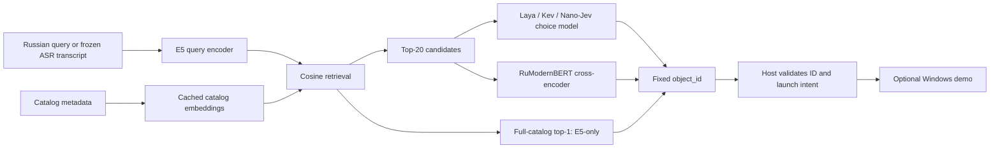

# Russian Command Routing

**Fine-tuning and evaluating retrieval, reranking and decision models for Russian text and speech-derived commands.**

The task is to select one object from a catalog of applications, files and folders. Queries can describe an object's purpose, contain typos, switch alphabets or arrive as noisy speech transcripts. Models return a catalog ID; the Windows demo opens that object through ordinary host code.

This repository contains the datasets, training code, Kaggle notebooks, experiment records and saved predictions. The desktop launcher is an application of the research. Its internal Python package keeps the original name, `jev_launcher`.

[Architecture](docs/ARCHITECTURE.md) · [Results and limitations](docs/RESULTS.md) · [Reproduce the checks](docs/REPRODUCIBILITY.md) · [Resume wording, RU/EN](docs/RESUME_RU.md)

## Research questions

- How much does task-specific fine-tuning improve selection on previously unseen objects?
- How do an embedding retriever, a cross-encoder reranker and a bounded decision model compare?
- Where do errors arise: a missing retrieval candidate or an incorrect choice inside the shortlist?
- What do clean-first training, quantization, catalog descriptions and temperature calibration change?

## Main results

Each test column below contains **150 commands on a new fictional catalog of 177 objects**. Clean text and ASR are paired representations of the same commands. ASR uses neural TTS, mild noise and real Whisper Large V3 transcription; it is not a human-speaker benchmark.

| Model / pipeline | Clean test | ASR test | Evaluation stage |
| --- | ---: | ---: | --- |
| Original E5, full-catalog retrieval | 143/150 · 95.33% | 136/150 · 90.67% | Initial frozen comparison |
| Fine-tuned E5, full-catalog retrieval | 145/150 · 96.67% | 143/150 · 95.33% | Later, already known suite |
| E5 → original Laya | 40/150 · 26.67% | 45/150 · 30.00% | Initial frozen comparison |
| E5 → fine-tuned Laya, step 568 | 141/150 · 94.00% | 141/150 · 94.00% | Initial frozen comparison |
| E5 → original Kev-0.8B | 143/150 · 95.33% | 143/150 · 95.33% | Initial frozen comparison |
| **E5 → fine-tuned Kev-0.8B, step 710** | **149/150 · 99.33%** | **146/150 · 97.33%** | Initial frozen comparison |
| E5 → fine-tuned RuModernBERT | 144/150 · 96.00% | 143/150 · 95.33% | Later, already known suite |

The initial comparison fixed the checkpoints before evaluating the new catalog. Kev's advantage over original E5 was **+4.00 percentage points on clean test** and **+6.67 on ASR test**; group bootstrap 95% intervals were `[+0.67, +8.00]` and `[+1.33, +11.33]`. These intervals describe this benchmark's groups, not variability across training seeds. Later E5 and reranker results are descriptive follow-up evaluations.

All 11 evaluated variants, saved predictions and the denominator for every result are in [the public evidence](results/README.md). The unusual zero accuracy of original Nano-Jev is retained with its diagnostics.


## Architecture



E5-only ranks all 177 objects. Decision models receive the same frozen original-E5 top-20, with a deterministic candidate permutation. Evaluation never inserts the correct object into a missed shortlist. Recall@20 and end-to-end top-1 are reported separately.

Fine-tuned E5 runs independently in the demo. Replacing the retriever before a fixed Laya with the fine-tuned E5 improved candidate coverage but reduced mean accuracy on the known suite from 88.15% to 87.95%. The two-stage pipeline therefore keeps the original retriever. [Pipeline experiment](docs/E5_LAYA_PIPELINE_RU.md).

## Fine-tuning

The authored training pool contains **22,656 synthetic examples**: 5,664 clean and 16,992 simulated STT variants, built from 708 source queries on eight fictional 177-object catalogs. Related variants stay grouped. Simulated STT corruption is distinct from actual ASR transcription.

| Family | Adaptation | Selected / completed optimizer updates |
| --- | --- | ---: |
| E5-small | Full encoder; per-query contrastive CE with frozen hard negatives; no new head | 142 / 568 |
| Laya multilingual | Encoder + native choice head; escalation head frozen | 568 / 994 |
| Kev-0.8B | Rank-16 LoRA + native pointer head; Qwen base frozen | 710 / 1,136 |
| RuModernBERT | Cross-encoder; listwise CE over 20 candidate scores | 426 / 852 |
| Nano-Jev | Full adaptation; mixed vs clean-first order | 1,416 / 1,416 each |
| RuBERT-tiny2 | Encoder + seeded scalar choice head | 142 / 568 |

The pool size is not the number of examples seen by every selected checkpoint. In particular, E5's selected step 142 falls inside the 2,272-example clean prefix, before the simulated-STT part.

Training used Kaggle Tesla T4, effective batch size 16, AdamW, warmup and gradient clipping. Periodic-stopping runs evaluated every 142 updates and selected checkpoints by group/profile-balanced validation NLL; the original Nano pair used final one-pass weights. Exact plans, selected/last weight hashes and training/validation ledgers are published in [results/training-runs.json](results/training-runs.json).

Training code: [E5](scripts/train_e5_kaggle.py), [Laya](scripts/train_laya_kaggle.py), [Kev](scripts/train_kev_kaggle.py), [RuModernBERT / RuBERT](scripts/train_modernbert_kaggle.py), [Nano-Jev](scripts/train_nanojev_kaggle.py). The [notebooks](notebooks/) preserve the original execution protocols; [reproduction instructions](docs/REPRODUCIBILITY.md) distinguish historical Kaggle inputs from public reruns.

## Other findings

- **Calibration:** one Laya temperature, `T = 2.49388`, fitted on 100 validation representations. A later application-order replay on 300 separate test representations reduced conditional NLL **0.4044 → 0.2410** and ECE **4.59% → 3.11%**, while keeping top-1 at **283/300**. Brier scores did not improve. This known-suite calibration is separate from the initial comparison above.
- **Training order:** Nano's clean-first schedule did not show a consistent advantage over mixed training on the new catalog. Both obtained 128/150 clean; mixed obtained 127/150 ASR versus 125/150 for clean-first.
- **Quantization:** dynamic INT8 Laya reduced accuracy on the old noisy-STT validation from 80% to 64%; repeated latency checks did not establish a consistent sub-500 ms pipeline.
- **Quality vs latency:** original/fine-tuned E5 took roughly 14–15 ms in full warm CPU checks; RuModernBERT roughly 118–148 ms. Kev's roughly 4.5 s result came from a small 12-query × 2 probe, so a full latency qualification is not claimed. All timings exclude ASR, model loading and initial indexing.

[Detailed results](docs/RESULTS.md) include the roles of old validation sets, later adaptations, negative results and timing protocols.

## Verify from a fresh checkout

Python 3.12+, standard library only; no GPU, API key or model download is needed:

```console
git clone https://github.com/matveyvarfolomeeev/russian-command-routing.git
cd russian-command-routing
python scripts/verify_public_results.py
```

This recomputes metrics from **4,400 saved predictions**, checks labels against public datasets, verifies SHA-256 hashes and recalculates Laya's temperature transformation, NLL and ECE. It also verifies the 22,656-example frozen training archive. It checks recorded evidence; it does not rerun model inference or training.

[Reproduction guide](docs/REPRODUCIBILITY.md) covers dataset validation, tests and a portable E5 training bundle.

## Repository map

| Path | Contents |
| --- | --- |
| [data/benchmarks](data/benchmarks/) | Basic, difficult, ASR, transfer and new-catalog evaluation data |
| [data/training](data/training/) | Clean and simulated-STT source data, catalogs and manifests |
| [data/prepared](data/prepared/) | Compressed, frozen top-20 training/validation inputs |
| [scripts](scripts/) | Dataset generation, fine-tuning, evaluation, export and audits |
| [notebooks](notebooks/) | Original Kaggle training and evaluation notebooks |
| [results](results/) | Public predictions, run plans, ledgers, calibration and hashes |
| [docs](docs/) | Architecture, experiment reports and reproduction instructions |
| [src/jev_launcher](src/jev_launcher/) | Optional Windows/Qt application and host-side execution |
| [tests](tests/) | Dataset, training, inference-boundary and application checks |

## Windows application

The demo provides a catalog editor, persistent model worker, text/voice quick panel and stale-result cancellation. Model inputs contain names, kinds, descriptions and aliases. Paths, launch arguments and credentials remain host-side. A valid model output alone does not authorize a launch.

<details>
<summary>Application preview and setup</summary>


See [the launcher guide](docs/LAUNCHER_GUIDE_RU.md). Windows x64 and Python 3.12 are the tested application environment. The source snapshot does not include a portable pretrained executable or model weights. A fresh source install can use the text filter; neural profiles require local weights and a configured runtime.

</details>

## Scope and limitations

Labels and ASR meaning preservation were reviewed by the author. Most data is synthetic, speech is TTS and each training recipe has one recorded seed. Clean/ASR pairs are correlated. Earlier test sets became known during the research and must not be reused as fresh blind confirmation. The benchmark contains unambiguous single-object `open` requests; abstention, clarification and destructive actions are not evaluated.

Original project code and authored synthetic data are under [MIT](LICENSE). Models and their native implementations retain their upstream licenses; pinned sources are listed in [third-party notices](THIRD_PARTY_NOTICES.md).
