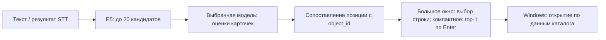

# Модели в приложении и фиксация экспериментов

Historical experiment record. Paths under `artifacts/` refer to local files; published predictions and ledgers are in [public evidence](../results/README.md).

7 октября 2026 года основной выбрана **дообученная Laya FP32, шаг 568**. Причина выбора — учебный проект посвящён decision-моделям; приоритетом стало использование такой модели, с сохранением быстрых альтернатив. Это выбор системы для приложения. Сами веса по-прежнему выбраны по прежней validation NLL, а не заново по просмотренным test-результатам.

Выбранный SHA-256: `acc8ee1848ae7c2fcca1b8e640b76823d8990482c0be2af592f987cd234f6bcc`.

## Как пользоваться

8 октября список сокращён до **трёх обученных моделей**. Вкладка «Поиск» содержит список **«Модель»**:

- **Laya FP32, шаг 568** — основная decision-модель учебного проекта: 80% сложного STT, 94% нового ASR test. Полный известный путь даёт около 0,78 с; стабильные полсекунды не подтверждены.
- **RuModernBERT, шаг 426** — быстрый reranker для сравнения архитектур: 71% сложного STT, 95,3% нового ASR test, повторные медианы 0,12–0,15 с. По измеренным средним он не превосходит дообученную E5.
- **Дообученная E5, шаг 142** — самостоятельный быстрый поиск: 82% сложного STT, 95,3% нового ASR test, повторные медианы 14–15 мс. В GUI это профиль `e5_trained`.

Текстовый фильтр по подстроке сохранён отдельно как режим без модели. Nano, Laya INT8 и исходная E5-only убраны из обычного списка; их эксперименты и веса сохранены. Предыдущая настройка `e5` выбирает дообученную E5; для убранных Nano/INT8 применяется основная Laya. Короткий связный отчёт с обоснованием выбора: [PROJECT_RESULTS_RU.md](PROJECT_RESULTS_RU.md).

Выбор сохраняется в локальной базе. Введите текст или распознайте голосовую команду; модель выведет подходящие варианты, первый — её предпочтение. Открытие происходит после **Enter, кнопки или двойного клика**. Каталог на отдельной вкладке можно редактировать независимо от выбранной модели.

Вычисления идут в фоне. При изменении запроса, модели или каталога прежний ответ отбрасывается. Пока выбирается новый объект, результаты предыдущего запроса не остаются доступными для случайного открытия. Несколько быстрых изменений ввода не создают очередь всех промежуточных команд.

Модель загружается в фоне при запуске приложения и переключении выбора, затем остаётся в собственном процессе до переключения или выхода. Индекс активного каталога готовится до сигнала готовности. Ранний замер подключения с загрузкой при первом запросе давал около 14 секунд для холодной Laya и около 654 мс после загрузки; он описывает предыдущую версию. Текущая проверка предзагрузки и двух окон находится в [QUICK_LAUNCH_RU.md](QUICK_LAUNCH_RU.md). Полные прежние замеры и их ограничения находятся в [сравнении моделей](FINAL_MODEL_COMPARISON_RU.md).

## Что подключено



Голос сначала превращается в текст через текущий Whisper Large-V3. Laya и RuModernBERT получают shortlist исходной E5 по полному активному каталогу, название, тип, описание и aliases. Обученная E5-only ранжирует каталог самостоятельно и заканчивает выбор на этапе retrieval. ID служат для сопоставления на стороне программы; пути и команды запуска в модель не передаются. Текстовый фильтр работает отдельно.

GUI использует существующий пул Qt-задач. Сервис сохраняет один локальный Python-процесс: выбранные веса и индекс готовятся в фоне при запуске и переключении модели. Сигнал `loaded` означает загрузку весов, `ready` приходит после подготовки индекса и прогрева настоящего пути inference. Оба окна используют этот процесс; открытие компактной панели не перечитывает веса. Раздельные среды сохраняют проверенные версии Transformers для Laya и ModernBERT. Обработка запроса не обращается к сети; загрузка весов закреплена локальными файлами и SHA. Score E5 — cosine similarity; softmax остальных — сравнение предъявленных кандидатов. В компактной панели открывается top-1 только после Enter; score не задаёт порог автоматического открытия.

Дообученная E5 загружает выбранный FP32 ONNX напрямую с диска, с проверкой SHA ONNX и tokenizer. Она не загружает исходную E5 и не использует её индекс. Каталог пересчитывается новыми весами; папка индекса содержит SHA обученного ONNX, чтобы другой checkpoint не получил чужие embeddings. Прежний индекс Laya/RuModernBERT сохраняется отдельно.

Код: `src/jev_launcher/model_search.py`, `src/jev_launcher/controller.py`, `scripts/run_launcher_model.py`. Worker переиспользует прежние проверенные загрузчики, native формат карточек, Windows CPU loader и E5 из model-worktree. Для каталога меньше 20 объектов число вариантов уменьшается.

В обычном поиске порядок кандидатов перемешивается детерминированно по тексту запроса. На 100 известных шумных STT validation-запросах этот путь Laya дал **35/50 на реальном каталоге и 45/50 на синтетическом, среднее 80%**. Прежний закреплённый порядок benchmark давал 34/50 и 46/50, тоже 80%; множества кандидатов совпали. Проверка подключения сохранена отдельно от прежнего сравнения. Веса и критерий их выбора не менялись.

## Локальное окружение

Конфигурация этого ПК находится в игнорируемом Git файле `models/launcher-runtime.json`. Она ссылается на выбранные Laya/RuModernBERT checkpoints, обученный E5 ONNX, файл калибровки Laya и существующие CPU-среды; исходные веса не заменяются.

Настройка из корня проекта:

```powershell
.\.venv\Scripts\python.exe scripts\configure_model_runtime.py `
    --model-worktree 'C:\Users\matva\.codex\worktrees\c58b\jev_pet'
```

Другую среду можно указать через `--decision-python` и `--reranker-python`. `JEV_MODEL_RUNTIME` переопределяет путь конфигурации. Модели требуют существующих скачанных файлов; если среда или веса отсутствуют, приложение показывает ошибку. Текстовый фильтр доступен отдельно.

При сборке `scripts/build.ps1` локальная конфигурация, текущий worker и его Python-загрузчики включаются в Qt-сборку. Упакованный EXE запускает bundled worker с тем же протоколом готовности. Сама папка Qt-приложения не содержит многогигабайтные веса, E5/model-worktree и обе Python-среды. Для переноса на другой ПК нужно перенести/настроить окружение и пересоздать пути конфигурации.

## Где зафиксированы эксперименты

- [EXPERIMENT_REGISTRY.json](EXPERIMENT_REGISTRY.json) — текущий машиночитаемый реестр: 27 записей об обучении и проверках, включая адаптацию E5, метаданные, парную замену E5 перед Laya, калибровку и финальное подключение трёх моделей; контрольные суммы и роли данных сохранены.
- [FINAL_MODEL_COMPARISON_RU.md](FINAL_MODEL_COMPARISON_RU.md) — итог по шумному STT, новому каталогу и скорости.
- [EXPERIMENTS.md](EXPERIMENTS.md) — подробная хронология; ссылки на отдельные отчёты и графики.
- evidence.zip v3 (`artifacts/experiment-archive-v3/evidence.zip`) — неизменяемая копия первых 22 этапов с собственным manifest. Пять последующих этапов хранятся отдельно и записаны в текущем реестре. Предыдущий архив v1 (`artifacts/experiment-archive-v1/evidence.zip`) сохранён как снимок проверки подключения приложения 7 октября.
- `artifacts/kaggle/outputs` — исходные выбранные и последние checkpoints. Крупные файлы весов хранятся отдельно; их SHA закреплены в реестре.

Неудачная AMP FP16 попытка Kev не считается обученной моделью: градиент стал нечисловым до первого обновления. У повторов оценки с одним журналом без подтверждённых результатов статус сохранён как неудачная попытка. Диагностические последние веса Nano также отделены от выбранных.

Старый шумный STT и новый Large-V3 набор имеют разную сложность. Синтетическая старая validation участвовала в stopping; известный новый test уже просмотрен. Эти роли сохранены в реестре, чтобы последующая документация не представляла сравнение как новую слепую проверку.

## Автоматические описания

Обновление каталога теперь дополняет пустые описания из Windows version resources и метаданных подтверждённых установленных пакетов WinGet. Существующие описания и ручные правки сохраняются; сетевые обращения идут в фоновой задаче обновления, затем результат используется из кэша. На этом ПК применены 12 описаний: 66 → 78 из 139 приложений. Их влияние на E5/Laya смешанное, поэтому результаты зафиксированы отдельно. [Реализация, ограничения и замеры](APP_DESCRIPTIONS_RU.md).

## Проверка обученной E5 перед Laya

8 октября завершены 974 парных запроса с одной фиксированной Laya: known800, real150 на обновлённых карточках и author24. Исходная E5 → Laya дала 722/800, обученная E5 → Laya — 718/800; macro10 88,15% → 87,95%, старый STT 80% → 78%. На real150 обе цепочки дали 117/150, на author24 — 19 → 21. Весь путь использует реальное перемешивание приложения, поэтому новый baseline отличается от прежнего canonical benchmark.

Основная цепочка сохраняется: **исходная E5 → Laya FP32 шага 568**. Обученная E5-only даёт 735/800 на known800 и 126/150 на обновлённом реальном каталоге. Последующим этапом она подключена в GUI как самостоятельный быстрый вариант. Новый retriever для Nano/RuModernBERT/INT8 и Kev в парном опыте не проверялся. [Отчёт, скорость и первичные файлы](E5_LAYA_PIPELINE_RU.md).

## Подобранная температура

После парного опыта отдельно подобрана **T = 2,4938812077079957** на independent validation100; проверка test300 использует другие группы. NLL test 0,4044 → 0,2410, ECE 4,59% → 3,11%, top-1 остаётся 283/300. У старого STT NLL выросла, а ECE снизилась; калибровка не улучшает каждую метрику каждого набора.

Worker теперь явно делит logits Laya на эту T только при 20 кандидатах. Для меньшего shortlist остаётся T = 1. Проверяются SHA файла калибровки и его соответствие выбранным весам. T = 0,1 также измерена: она усиливает ошибочную уверенность и ухудшает NLL. Порог автоматического открытия не вводится. [Протокол, таблица и ограничения](LAYA_TEMPERATURE_RU.md), [учебное объяснение](LEARNING_ANSWERS_RU.md#25-подобрана-ли-температура-laya-и-меняет-ли-она-выбранное-приложение).

## Проверки финального подключения

68 тестов прошли: список моделей, переключение и сохранение настроек, отбрасывание устаревших ответов, оба окна, изоляция launch-данных, метаданные и численная устойчивость scores. Живые offline workers проверены на48 запросах каждый с полными каталогами177: E5/RuModernBERT воспроизводят прежние top-1, Laya сохраняет весь порядок ID и выдаёт калиброванные probabilities. Отдельный упакованный worker проверен на8 запросах каждой модели. Его loaders побайтно совпадают с проверенными исходниками; Windows-сборка пересобрана.

Сохранены runtime-check.json (`artifacts/model-integration-v2/runtime-check.json`), bundled-worker-check.json (`artifacts/model-integration-v2/bundled-worker-check.json`) и build.log. Эти проверки не являются новым независимым quality benchmark или единым повторным замером скорости всех моделей. Чистая установка на другом компьютере не проверена; веса и ML-среды по-прежнему находятся отдельно от Qt-сборки.
