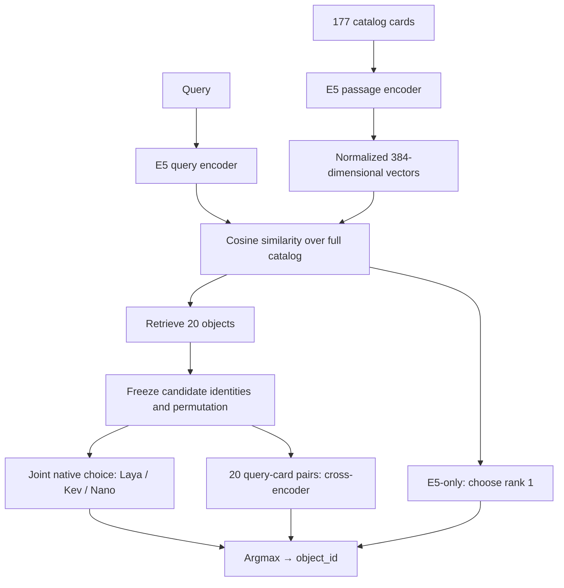
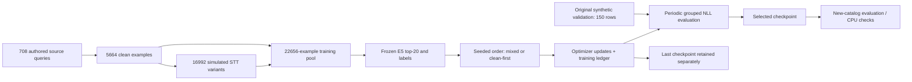

# Research architecture

The research task is bounded object selection: given a Russian query `q` and catalog `C`, return one existing `object_id`. The benchmark supplies one target per request. The system does not generate shell commands or invent catalog objects.

The experiment compares three approaches: full-catalog embedding retrieval, retrieval followed by a choice model, and retrieval followed by a cross-encoder. The Windows application demonstrates the boundary between model selection and host-side execution.

## Inputs and isolation

```json
{
  "object_id": "synthetic-example-id",
  "name": "Example Editor",
  "kind": "app",
  "description": "Редактор исходного кода",
  "aliases": ["редактор", "IDE"]
}
```

This is the model-safe part of a catalog entry. Filesystem paths, Windows AppIDs, executable arguments and credentials are excluded. `Catalog.model_catalog()` supplies safe metadata in the application. A labeled benchmark row adds `expected_object_id` and `group_id` for evaluation; these labels do not enter the query encoder's input.

Card rendering joins name, Russian kind, description and aliases. E5 prefixes the query with `query: ` and the card with `passage: `. Changing descriptions changes the retrieval problem; metadata ablations therefore keep weights and labels fixed.

## Retrieval and model choice



**E5 bi-encoder.** Query and cards are encoded independently. Attention-mask mean pooling and L2 normalization produce vectors; cosine similarity ranks every catalog object. Card vectors are cached and invalidated when metadata or encoder weights change. Fine-tuning updates the shared encoder with per-query cross-entropy on target versus 19 frozen hard negatives, using cosine scores divided by 0.01. No classification head is added. Its checkpoint-selection validation ranks all 177 objects.

**Laya native choice model.** The multilingual encoder reads the query and candidate descriptions through the upstream native choice format. The encoder and choice head are fine-tuned; the separate escalation head stays frozen. The native option budget is 48 tokens per card. The runner checks that query/option markers survive the 8,192-token sequence/head budget; that check does not mean the native card budget has been removed. Weights and validation are FP32, while recorded training uses FP16 autocast.

**Kev-0.8B pointer model.** A frozen Qwen3.5-0.8B-Base backbone runs the supplied state/options without generating text. Rank-16 LoRA adapters and the native pointer head are trainable, approximately 11.35M parameters in the recorded configuration. The adapter is kept separate from the base, and training/validation use FP32. The runner checks native input length, marker positions and warm-start provenance.

**Nano-Jev.** A compact native choice model receives the same frozen candidates. Both full-adaptation runs start from the same weights and consume the same example multiset, using either mixed ordering or a clean prefix followed by a mixture. Original, mixed and clean-first checkpoints are kept as separate conditions. The original model's zero top-1 result is a measured outcome of this protocol; its cause is not established.

**RuModernBERT / RuBERT-tiny2 cross-encoder.** Each query-card pair gets a scalar score. Listwise cross-entropy compares the 20 scores for a query. RuModernBERT starts from a Russian reranker; RuBERT-tiny2 receives a seeded scalar head. Full-catalog E5 retrieval remains outside the cross-encoder. The new tiny head is an experimental adaptation, not a pretrained decision-model capability.

The [pinned source manifest](../results/source-models.json) identifies upstream model and native-code revisions. These models and native libraries are external dependencies.

## Retrieval and selection metrics

For a two-stage pipeline, correct top-1 requires both target inclusion and a correct choice. A target missing from top-20 contributes an end-to-end error even if the choice model performs well on reachable cases.

- `recall@20`: fraction of all requests whose target is in the retrieval shortlist.
- `top-1 accuracy`: fraction of all requests whose selected ID equals the target.
- `conditional accuracy / NLL`: selection quality on requests with a reachable target.

Training preparation may insert a missing positive to construct a supervised contrastive example. The frozen pool contains 5 clean and 46 simulated-STT positive insertions. Evaluation performs **zero positive insertions**. Candidate IDs are deterministically shuffled, and the initial decision-model comparison reuses identical candidate identities and order.

This decomposition matters in the retriever ablation: fine-tuned E5 brought more targets into top-20 before fixed Laya, yet Laya chose less accurately overall. Better coverage does not guarantee a better cascade.

## Training and checkpoint selection



The first 2,272 rows of a clean-first schedule are clean; the remaining pool is shuffled. This is a curriculum/order experiment, not a second dataset. Effective batch size is 16. For periodic-stopping runs, selection loss averages reachable-target NLL within each group, then across groups and the three validation profiles; E5 instead validates over the full catalog. Evaluation occurs every 142 updates with patience 3 and minimum improvement 0.005. The original Nano mixed/clean pair uses final one-pass weights.

The selected checkpoint can precede the completed run by hundreds of updates. Plans, selected/last SHA-256 hashes and per-step ledgers preserve that distinction. E5's selected step 142 has seen only the clean prefix, so its result does not establish a benefit from simulated-STT training.

## Evaluation boundary

The new-catalog suite has 200 commands: 50 validation and 150 test, grouped into 10 and 30 target groups. Clean and ASR are correlated representations of each command. The initial checkpoints were fixed before retrieval/inference on this suite. Later E5/reranker experiments report the now-known suite descriptively.

The initial study uses paired group bootstrap intervals with 10,000 resamples; entire target groups are resampled. This captures variation across groups within a profile, not across training seeds or human authors. Training/evaluation IDs, targets, query normalization, object metadata and audio hashes have separate overlap guards. Such checks detect the listed collisions; they do not prove universal semantic novelty.

## Calibration

A scalar temperature rescales Laya logits before softmax; it changes confidence without changing argmax. The scalar is fitted on 100 validation representations from 10 groups and examined on 300 test representations from 30 other groups, using a later replay with the application's candidate order. This suite was already known. The setting is specific to the recorded FP32 checkpoint, original E5 and 20 candidates; smaller shortlists retain `T=1`.

Conditional NLL excludes the one unreachable test target; top-label ECE includes every request. Both definitions are preserved in the public verifier. Calibrated confidence is not treated as launch authorization, and improved NLL/ECE does not imply every probability metric improved.

## Optional Windows runtime

Qt/QML UI → request/session IDs → persistent model subprocess → returned IDs → host validation → `launch_by_id`.

The host owns the SQLite catalog and actual launch targets. Background work carries query/session IDs; stale results are rejected after input, model, catalog or session changes. The model worker emits `loaded` after loading weights and `ready` after preparing the index and warming inference. Hub and compact panel reuse that worker. Enter expresses the user's launch intent, while repeated Enter and cancelled sessions cannot repeat an opening.

The research benchmark calls no Windows launch operations. The demo does not evaluate clarification, calibrated abstention or arbitrary command execution. Detailed engineering notes remain in [the launcher architecture](LAUNCHER_ARCHITECTURE_RU.md) and [launcher guide](LAUNCHER_GUIDE_RU.md).
