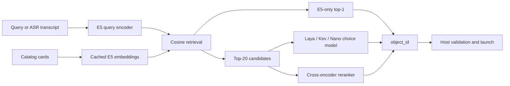

# Architecture

The input is a Russian query and a catalog of objects. The output is one existing `object_id`. Catalog cards contain a name, kind, description and aliases; paths and launch arguments stay in the host application.

## Models

**E5:** query and card encoders share weights. Masked mean pooling and L2 normalization produce 384-dimensional vectors; cosine similarity ranks all 177 objects. Inputs use `query:` and `passage:` prefixes with a 512-token limit. Fine-tuning uses per-query cross-entropy over the target and 19 frozen hard negatives, at temperature 0.01. There is no new classification head. Catalog embeddings are rebuilt after weight or metadata changes.

**Laya:** the multilingual encoder reads the query and candidate cards in the native choice format. The encoder and choice head are trained; the escalation head stays frozen. The native budget is 48 tokens per card, within an 8,192-token sequence/head limit. Training uses FP16 autocast with FP32 weights and validation.

**Kev-0.8B:** a frozen Qwen3.5-0.8B-Base backbone with rank-16 LoRA and a native pointer head. It scores supplied options without generating text. About 11.35M parameters are trainable in this configuration. The recorded run keeps adapters unmerged and uses FP32 training and inference.

**RuModernBERT / RuBERT-tiny2:** each of the 20 query-card pairs gets a scalar score; listwise cross-entropy trains the selection. RuModernBERT starts from a Russian reranker. RuBERT-tiny2 gets a seeded scalar head.

**Nano-Jev:** a compact native choice model, adapted on the same candidate data. Mixed and clean-first runs start from the same weights and use the same example multiset.

Pinned model and native-code revisions are in [source-models.json](../results/source-models.json).

## Retrieval and selection

Choice models receive frozen original-E5 top-20 candidates in a deterministic shuffled order. Training inserts a missing positive in 5 clean and 46 simulated-STT examples. Evaluation never inserts a target.

End-to-end top-1 counts every request, including retrieval misses. Recall@20 measures target coverage; conditional accuracy/NLL measure selection only when the target is reachable. These are separate metrics.

The application keeps original E5 before Laya. Substituting fine-tuned E5 improved coverage but reduced known-suite mean accuracy from 88.15% to 87.95%.

## Application

`Catalog.model_catalog()` supplies safe metadata. `model_search.py` manages a persistent subprocess; `quick.py` and `controller.py` reject stale results after input, model, catalog or session changes. The worker reports `loaded` after weight loading and `ready` after indexing and warmup. `launch_by_id` checks the selected ID and opens the host-owned target after the user's launch request.
