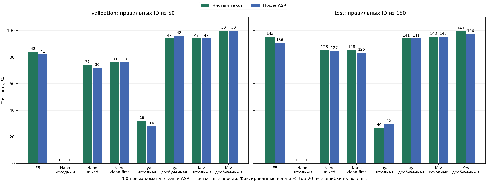

# Проверка моделей на launcher-independent-v1 — 2026-10-06

Historical experiment record. Paths under `artifacts/` refer to local files; published predictions and ledgers are in [public evidence](../results/README.md).

На новом каталоге и новых запросах лучший измеренный результат получил **дообученный Kev, шаг 710**: validation **50/50 clean и 50/50 ASR**, test **149/150 clean (99,33%) и 146/150 ASR (97,33%)**. Исходный Kev на test получил 143/150 в обоих представлениях. Перенос обучения на новые объекты подтверждается этим сравнением; отсутствие переобучения на любых будущих данных и пригодность по скорости оно не доказывает.

**1. Что именно проверяли.**

Набор пользователя содержит 200 авторских команд на новом вымышленном каталоге из 177 объектов: 139 приложений, 20 папок и 18 файлов. У объектов заполнены описания. Validation содержит 50 команд из 10 групп; test — 150 команд из 30 других групп и с другими целями. У каждой команды два связанных представления: исходный текст и настоящий результат Groq Whisper Large V3 на новой нейронной TTS-записи с мягким шумом. Получаются 400 строк оценки, но **200 отдельных команд**, а не 400 независимых задач.

Полная проверка исходников и аудио прошла. Против 47 прежних файлов с 25 555 вхождениями запросов, включая 21 248 уникальных нормализованных текстов, нет проверенных совпадений запросов, ID объектов/примеров/групп, названий/aliases, описаний, хешей аудио и голосов. Это проверка перечисленных пересечений, а не доказательство новизны каждого смыслового намерения. Разметка и сохранность смысла ASR проверены автором; независимой человеческой проверки нет. Аудио синтезировано, реальные человеческие дикторы здесь не проверяются. ASR дал 200 непустых ответов; 39 нормализованных текстов изменились, 161 остался прежним.

Все семь исходных и обученных checkpoint закреплены **до retrieval и inference**. Laya, шаг 568, и Kev, шаг 710, ранее выбраны по прежней обычной synthetic validation. Новый набор не участвовал в обучении, early stopping, выборе checkpoint или настройке порогов. Хотя часть набора названа validation, в этой проверке её роль также только оценочная. После просмотра результатов этот test уже изучен: настройка следующих изменений на его ошибках потребует нового отложенного подтверждения.

**2. Все результаты.**

Во всех ячейках указано число правильных object_id. Decision models получают одинаковые закреплённые E5 top-20 с одинаковой перестановкой кандидатов; E5-only выбирает собственный первый результат. Цели в evaluation не добавляются принудительно. Clean и ASR, validation и test считаются отдельно.

| Модель | Validation clean / 50 | Validation ASR / 50 | Test clean / 150 | Test ASR / 150 |
| --- | ---: | ---: | ---: | ---: |
| E5-only | 42 | 41 | 143 | 136 |
| Nano-Jev исходный | 0 | 0 | 0 | 0 |
| Nano-Jev mixed | 37 | 36 | 128 | 127 |
| Nano-Jev clean-first | 38 | 38 | 128 | 125 |
| Laya исходная | 16 | 14 | 40 | 45 |
| Laya дообученная, шаг 568 | 47 | 48 | 141 | 141 |
| Kev исходный | 47 | 47 | 143 | 143 |
| **Kev дообученный, шаг 710** | **50** | **50** | **149** | **146** |



Сильное улучшение Laya относительно исходной версии сохраняется на новых объектах. На clean test она немного уступает E5; на ASR test превосходит его по числу правильных ответов. Надёжного преимущества Laya над E5 по приведённым ниже интервалам не установлено. У Nano обе схемы дают 128/150 clean; mixed получает на два правильных ASR-ответа больше clean-first. **Устойчивое превосходство чистого старта этим экспериментом не установлено**; для Laya/Kev сравнения двух схем обучения не проводилось.

Нулевой результат исходного Nano необычен, но воспроизведён на всех 400 CPU-строках: GPU/CPU top-1 совпадает, проверены исходный SHA, IDs, probabilities и соответствие выбранного кандидата. Это результат конкретной исходной модели и данного протокола; причинный диагноз её поведения здесь не установлен.

**3. Что известно о разнице качества.**

Сравнение попарное: модели отвечают на те же запросы. 95%-интервалы получены 10 000 bootstrap-перевыборками **целых групп**; в каждом test-профиле 30 групп. Clean/ASR не объединяются. Интервалы описывают вариативность этих групп и не учитывают различия между training seeds, авторами или будущими каталогами.

| Сравнение на test | Разница clean, п.п. [95% CI] | Разница ASR, п.п. [95% CI] |
| --- | --- | --- |
| Дообученный Kev − E5 | +4,00 [+0,67; +8,00] | +6,67 [+1,33; +11,33] |
| Дообученный Kev − исходный Kev | +4,00 [+0,67; +7,33] | +2,00 [−0,67; +4,67] |
| Дообученная Laya − E5 | −1,33 [−6,00; +3,33] | +3,33 [−1,33; +8,00] |
| Nano clean-first − Nano mixed | 0,00 [−3,33; +4,00] | −1,33 [−4,67; +2,00] |

Дообученный Kev исправляет 7 clean-ошибок E5 и теряет 1 его правильный ответ; на ASR исправляет 13 и теряет 3. Относительно исходного Kev он исправляет 7 clean-ошибок и теряет 1 успех; на ASR — исправляет 4 и теряет 1. Поэтому рост общей точности не означает, что все прежние правильные ответы сохранились. Прирост Kev над исходным на ASR небольшой, его интервал включает ноль.

Дополнительно посчитан group-balanced conditional NLL: среднее `−log(p_target)` внутри каждой группы, затем среднее групп **отдельно в каждом профиле**. Чем меньше, тем больше вероятность, которую модель в среднем выделяет правильным достижимым целям. Это дополнительный отчёт, а не новый критерий отбора весов.

| Модель | Validation clean NLL | Validation ASR NLL | Test clean NLL | Test ASR NLL |
| --- | ---: | ---: | ---: | ---: |
| Kev исходный | 0,15325 | 0,21705 | 0,17492 | 0,12401 |
| Kev дообученный | 0,02072 | 0,01600 | 0,01646 | 0,02921 |
| Laya исходная | 2,07550 | 2,29791 | 2,24590 | 2,24983 |
| Laya дообученная | 0,45943 | 0,39012 | 0,53238 | 0,34469 |

E5 cosine scores не являются вероятностями, поэтому такого сравнения NLL с E5 нет. В ASR test цель доступна в 149/150 shortlist: NLL вычислен на этих 149 строках, но общая accuracy оставляет все 150. Низкий conditional NLL не оценивает ошибку retrieval и не устанавливает калибровку confidence.

**4. Все ошибки выбранного Kev.**

Ошибок пять в 400 представлениях, но они относятся к **четырём исходным командам**. Validation ошибок не содержит. Clean test имеет одну ошибку выбора; ASR test — три ошибки выбора и один retrieval miss.

| Команда / представление | Правильный объект | Выбранный объект | Цель в top-20? | Score выбранного |
| --- | --- | --- | --- | ---: |
| Перенос семян из тёплой среды в холодную, clean | Семенная стратификация | Тепличная рассада | Да | 0,76839 |
| Та же команда, ASR | Семенная стратификация | Тепличная рассада | Да | 0,61383 |
| Сопоставить влажность досок с этапом просушки, ASR | Камерная сушка | Тёплый валенок | Нет | 0,99875 |
| Учёт бегучего такелажа, ASR | Парусный такелаж | Тёплый валенок | Да | 0,85047 |
| Каталог реквизита «Хрустального карниза», ASR | Хрустальный карниз — реквизит | Хрустальный карниз — афиши | Да | 0,54072 |

У запроса о досках ASR изменил только начальный регистр и добавил точку относительно исходной фразы; смысл сохранился, но нужный объект вышел из E5 top-20. Дообучение Kev не может выбрать отсутствующий объект. Его score 0,99875 показывает уверенность **среди предъявленных вариантов**, а не вероятность того, что правильный объект вообще присутствует. Автоматическое открытие только по высокому score этим результатом не обосновано.

Для остальных ошибок правильный объект присутствует. Например, у «Хрустального карниза» probabilities двух первых вариантов близки: афиши 0,54072 и реквизит 0,45928. Это материал для будущей проверки пользовательского выбора и калибровки; порог показа вариантов здесь не выбирался. Полные тексты, IDs, target probabilities и top-3 сохранены в trained-kev-errors.json (`artifacts/kaggle/independent-v1/trained-kev-errors.json`).

**5. Проверки исполнения и границы результата.**

Все семь checkpoint оценены на всех 400 строках GPU в FP32, Tesla T4 / Torch 2.11.0+cu128, без optimizer updates и квантования. У Kev исходная или обученная LoRA загружается отдельно от базовых весов, без их слияния; temperature равна 1.0. Полный аудит проверил входные и checkpoint SHA, полноту IDs, ровно 20 probabilities, их конечность/сумму, соответствие argmax выбранному ID, accuracy counts и происхождение файлов. Итог: `audit=passed`.

У Nano максимальная длина пары — 229 токенов, обрезок нет. У Kev максимальная последовательность — 723 токена, запрос — 26; запросы и metadata не обрезаны, dummy label удалён из входа. Laya использует родной предел 48 токенов на вариант: из 8 000 предъявлений вариантов затронуты 6, отброшено всего 6 metadata-токенов; одинаково для исходной и обученной модели. Максимальная последовательность — 719 токенов, дополнительные обрезки запросов/общего бюджета не применялись. Отсутствие любых обрезок Laya не заявляется.

CPU-сверка завершена: исходный Nano и mixed Nano проверены на **всех 400 строках**; clean-first Nano, выбранная Laya и выбранный Kev — на **12 заранее закреплённых строках каждый**, по три на профиль. Top-1 различий нет. Максимальное расхождение probabilities среди этих сверок — 6,32e-6. Полной CPU400-проверки двух крупных выбранных моделей это не заменяет. Вспомогательный CPU400-прогон Kev остановлен после готового GPU400 и CPU12; он не выдаётся за полный CPU-результат.

В приватном [Kaggle notebook](https://www.kaggle.com/code/matveyvarfolomeev/launcher-independent-models-v1) пять Nano/Laya-моделей полностью посчитаны в версии 2; затем ошибочный жёстко заданный filename базового Kev прервал запись отчёта. Исправлена проверка имени существующего hash-checked shard, без изменения входов или весов. Версия 5 завершена и содержит оба полных Kev-результата. Агрегат явно объединяет проверенные пять результатов v2 и два v5; незавершённый v2 не обозначается завершённым notebook. Исходники и прогнозы не переписывались для получения удобных метрик.

Это измерение качества на одном полностью описанном вымышленном каталоге и авторских запросах. В реальном каталоге описания заполнены хуже, речь и шум могут отличаться. Полный CPU-лимит 3 секунды, RAM, калибровка, missing-object/ambiguity и GUI-интеграция требуют отдельной проверки. Новое обучение по изученному test не запускалось; изменения каталога, данных и confidence routing по его ошибкам не внесены.

После вопроса пользователя о скорости проведена короткая CPU-проба выбранных весов; результаты и её ограниченный объём записаны ниже. Это дополнительное измерение задержки, без изменения результатов качества или продуктового routing.

**6. Артефакты и воспроизведение.**

- comparison.json (`artifacts/kaggle/independent-v1/comparison.json`): все метрики, paired intervals, NLL, encoding и явные result sources.
- dataset-audit.json (`artifacts/kaggle/independent-v1/dataset-audit.json`): проверка источников, пересечений и аудио.
- fixed-checkpoints.json (`artifacts/kaggle/independent-v1/fixed-checkpoints.json`): заранее закреплённые файлы моделей и SHA.
- numerical-parity.json (`artifacts/kaggle/independent-v1/numerical-parity.json`): фактический объём CPU/GPU-сверки.
- [PNG](../assets/experiments/independent-v1-comparison.png) и SVG (`artifacts/kaggle/independent-v1/comparison.svg`): раздельные графики четырёх профилей.
- [Описание набора](../data/benchmarks/launcher-independent-v1/README.md) и [учебный разбор проекта](PROJECT_AND_TRAINING_RU.md).

Из корня проекта повторная проверка уже скачанных результатов не запускает обучение, приложения или новый ASR:

```powershell
.\.venv\Scripts\python.exe -X utf8 scripts\evaluate_independent_models.py --results artifacts/kaggle/outputs/independent-v5/results --previous-results artifacts/kaggle/outputs/independent-v2/results
```

Точность результатов проверена полными фактическими прогнозами и аудитом. Дополнительно существующие focused tests independent dataset / Nano training / Laya training дали 25 passed; Ruff и parsing новых evaluator/notebook файлов прошли. Это не заявление о новой полной проверке всего GUI-проекта.

**7. Почему исходный Nano показал ноль: факты и гипотеза.**

Ноль относится к исходному Nano-Jev v0.1. После нашего обучения mixed получил 128/150 clean и 127/150 ASR test, clean-first — 128/150 и 125/150. При этом исходный checkpoint предназначен для английских RAG-задач: relevance, sufficient и grounded. Автор отдельно предупреждает о других языках/доменах и необученных пользовательских наборах вариантов. Источник — [model card именно v0.1](https://huggingface.co/sdmlai/nano-jev/blob/v0.1/README.md), совпадающий с закреплённой локальной копией. Английский текст и три класса релевантности отличаются от нашей русской команды и двадцати карточек приложений/папок/файлов.

Токенизация даёт конкретную дополнительную улику. В 400 новых запросах нет `[UNK]`, но средние 7,865 слов превращаются в 49,415 WordPiece-токенов. Например, «Открой» разбивается на `о`, `##т`, `##к`, `##р`, `##о`, `##и`. Это почти буквенное представление русских слов английским словарём, а не исчезновение текста. Все пары помещаются в 512 токенов; обрезка не объясняет нулевой результат. Дообучение использует тот же словарь и всё же резко улучшает выбор, поэтому сама дробная токенизация не является доказанной единственной причиной.

В дополнительном контроле **родной API автора** воспроизводит неверный выбор «Семенная кладовая» вместо «Пасечного журнала» для первого нового запроса. Его top-1 совпадает с нашим evaluator, максимальное отличие probabilities — 2,83e-7. В родном relevance-примере корректный английский ответ про год основания UCL получает `directly answers=0,93776`; нерелевантный текст про суп — `irrelevant=0,92000`. Для русского перевода верного ответа `directly answers=0,18815`, а наиболее вероятен `partially relevant=0,66097`. Это маленький контроль работы модели и языковой чувствительности, а не статистический bilingual benchmark.

Исходный Nano выбирает 67 разных ID и все 20 позиций; это не постоянный выбор первого кандидата. Правильные достижимые цели часто находятся внизу его рейтинга: 76 из 399 на последнем месте. Переворот порядка дал бы только 76/400, а не восстановление корректной модели. Правило переворота не применялось.

Обоснованная рабочая гипотеза — сильное несоответствие языка, предметной области и задачи исходному обучению. Размер модели дополнительно ограничивает её возможности, но этим сравнением его причинный вклад не выделен. Точная причина того, почему в конкретном новом наборе получилось ровно 0/400, не установлена отдельным контролируемым экспериментом. Диагностика токенизации и рейтингов (`artifacts/kaggle/independent-v1/nano-original-diagnostics.json`); родной API и контрольные примеры (`artifacts/kaggle/independent-v1/nano-native-controls.json`).

**8. Свежая скорость дообученных Laya и Kev на CPU.**

Оба выбранных checkpoint проверены последовательно на **одних и тех же 12 заранее закреплённых CPU-parity запросах**: по три из каждого clean/ASR validation/test профиля. Два прогрева исключены; затем 12 запросов выполнены дважды, во второй раз в обратном порядке. Получилось 24 измерения на модель, а не 24 независимых запроса. Модели и индекс уже загружены. ПК: Intel Core i7-13700H, Torch 2.9.1+cpu, 4 Torch-потока, FP32, одна команда за вызов, 20 кандидатов. Пользовательские приложения не закрывались; сравнение не является строгим изолированным аппаратным benchmark.

Измеренный путь: свежий `E5.rank(query)` → top-20 и закреплённая перестановка → metadata и родная токенизация → forward → softmax → object_id. ASR, начальная загрузка весов/индекса, запись файлов и проверки после таймера исключены. В каждом измерении восстановлены те же входы и получен тот же top-1, что в полном GPU-аудите; probabilities отличаются менее чем на 1e-4. Сохраняются исходные выбранные веса, без квантования, merging или optimizer updates.

| Дообученная модель | Медиана полного запроса | p95 в пробе | Максимум в пробе | Запросов дольше 3 с |
| --- | ---: | ---: | ---: | ---: |
| Laya, шаг 568 | 1,009 с | 1,091 с | 1,106 с | 0/24 |
| Kev, шаг 710 | 4,502 с | 4,651 с | 4,784 с | 24/24 |

E5 retrieval занимает около 9 мс у обеих моделей; основное время приходится на neural choice, около 995 мс у Laya и 4 491 мс у Kev по медиане. В этой пробе Laya примерно в 4,46 раза быстрее. На полном новом ASR test её качество 141/150 (94%), Kev — 146/150 (97,33%): выигрыш Kev составляет пять ответов, а наблюдаемая CPU-задержка существенно больше. Quality counts и latency sample имеют разные объёмы и не смешиваются в новый общий score.

Ранее исходный Kev **INT8 с E5 top-10** на полном старом ASR benchmark имел p50 1,376 с, p95 1,756 с и максимум 3,346 с; задержка была квалифицирована как не прошедшая 3-секундный лимит. Исходная Laya FP32 top-20 там имела p50 0,870 с, p95 1,227 с и максимум 1,357 с. Это прежние исходные checkpoint, другое число вариантов/precision у Kev, старые запросы и другие Torch threads; их время нельзя выдавать за скорость нового trained FP32 top-20. Исходный отчёт: `C:/Users/matva/.codex/worktrees/c58b/jev_pet/docs/BENCHMARK_LAUNCHER_ASR_V1.md`.

Короткая проба не квалифицирует Laya на полном наборе по p95/max и не измеряет cold start или реальную речь. Однако текущий FP32-режим Kev уже превышает наш лимит на всех предъявленных запросах. При приоритете отзывчивости предпочтение пользователя в пользу Laya поддерживается этими измерениями. Окончательное подключение модели к GUI не выполнялось. Квантованный обученный Kev ещё не оценён по качеству и скорости; старый INT8-результат не заменяет эту проверку.

Исходные измерения: Laya probe.json (`artifacts/kaggle/independent-v1/speed-probe/laya/probe.json`), Kev probe.json (`artifacts/kaggle/independent-v1/speed-probe/kev/probe.json`); каждый соседний `probe-rows.jsonl` содержит все 24 индивидуальных времени и GPU parity. Одноразовый runner (`artifacts/kaggle/independent-v1/speed-probe/timed_choice_probe.py`) переиспользует существующие проверенные loaders и encoder, не меняя production-код.
