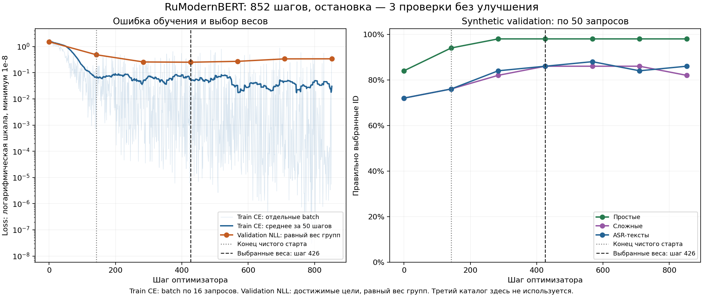

# Russian ModernBERT launcher adaptation

The user authorized one exploratory fine-tuning of the compact Russian reranker and asked whether Nano-Jev can improve further. This experiment adapts launcher choice; the source model already knows Russian. The Nano continuation was subsequently authorized on2026-10-07 and completed as a separate experiment; see [its report](KAGGLE_NANOJEV_CONTINUATION_RU.md).

## Source and native interface

- Model: [ARGA100/ru-reranker-modernbert-small](https://huggingface.co/ARGA100/ru-reranker-modernbert-small), MIT according to its model card.
- Pinned revision: `8d4ea05d7c793bc812879ca18e7e310ac4cb228f`.
- Original weight SHA256: `5e13407da1fdb11fc4b5ca660daea6edbecfa25825665b776eb115cffc402e4b`.
- Actual loaded parameters: 34,539,649; twelve layers, hidden size384, native scalar relevance head.
- Exact loading uses Transformers5.12.1 and native SDPA, with compile/reference_compile disabled. No missing, unexpected or mismatched checkpoint keys are accepted. Existing model environments were retained; a task-local environment reuses installed Torch without updating the other models' Transformers.

Each candidate receives one native `(query, card)` pair. Twenty scalar logits become a choice softmax; target object IDs only supply the correct index for cross-entropy. Scores are uncalibrated after adaptation. The model does not generate IDs or opening commands.

## Frozen protocol

The existing 22,656 fictional training rows and150 synthetic validation rows are byte-identical to Nano/Laya/Kev inputs. Training has5,664 clean plus16,992 simulated-STT rows. Related train/validation groups are disjoint. All twenty cards and their shuffled order are preserved; the51 existing training-only positive insertions remain recorded, while evaluation insertion is zero. Personal catalogs and test examples are excluded from the private training upload.

Clean-first starts with2,272 clean rows, then mixes the remainder. Effective batch16, GPU microbatch2, AdamW lr2e-5, weight decay.01, warmup6%, gradient clipping1.0. All model parameters, activations, optimizer and validation are FP32. Maximum one pass/1,416 successful updates. Non-finite losses or gradients abort before claiming an update.

Validation runs every142 updates. Checkpoint selection uses the existing equal-profile, equal-group NLL on reachable labels; E5 misses still count against reported end-to-end accuracy. Patience3/min_delta.005. Baseline weights are eligible; if no significant improvement occurs, best_step remains0. Independent/transfer scores never select weights.

## Preflight and measured baseline

All453,120 training pairs and3,000 validation pairs fit without truncation: maximum78/60 tokens, mean38.67/32.13. Changing target/provenance does not change native inputs. Reversing candidates restores logits within8.35e-7 and preserves the selected candidate. A CPU smoke run completed two finite updates and checkpoint saving; it does not establish quality gains. Twelve focused tests and notebook Python-cell compilation passed. Actual trained checkpoint reloading was subsequently checked in the full local evaluation and timing runs.

On the same800 known evaluation representations, before adaptation:

- Equal weight of ten scenarios: **71.50%**.
- Equal weight of all rows: **76.375%**,611/800.
- Other fixed models under the ten-scenario mean: E580.50%, trained Nano clean-first79.05%, trained Laya FP3287.85%, trained Laya INT878.75%.

This is a known comparison/regression suite, not a new blind test. Independent validation/test roles are merged only within clean/ASR for this descriptive ten-scenario average; training selection still uses only the original150 validation rows.

Two complete warm CPU400 repetitions of the original model used the same i7-13700H policy as quantization: six Torch threads, one logical thread per P-core, E5 spinning disabled, cached fictional177-object catalog. The timer includes fresh E5 retrieval, shuffled20 metadata cards, native tokenization/inference and ID mapping; it excludes ASR, loading, initial indexing, writes and integrity checks.

| Repetition | Median | p95 | Maximum | Above500ms |
| --- | ---: | ---: | ---: | ---: |
| 1 |111.74ms|149.86ms|301.95ms|0/400|
| 2 |134.86ms|172.64ms|468.79ms|0/400|

All800 timed IDs reproduce the frozen quality reference; maximum probability difference5.07e-7. These are measured conditions, not a guarantee under arbitrary future load.

## Completed GPU run and checkpoint selection

Notebook: [launcher-russian-modernbert-clean-first-v1](https://www.kaggle.com/code/matveyvarfolomeev/launcher-russian-modernbert-clean-first-v1), private. Dataset: [launcher-modernbert-training-v1](https://www.kaggle.com/datasets/matveyvarfolomeev/launcher-modernbert-training-v1), private. Version1 completed on2026-10-07, Tesla T4/Torch2.11.0+cu128/Transformers5.12.1. Script time681.37seconds, **11min21sec**; this excludes Kaggle queue/startup and dependencies. The remotely downloaded input manifest matches SHA256 `cabb5d2913fb4ac25ed70ee9e9bdb6d4a0c592cf6fef5a8464be5431f0eb5782`. Notebook checks that exact manifest before training. Submission had a7200-second limit.

Completed852 finite optimizer steps,13,632 row exposures; **selected426**,6,816 exposures. Stop reason `validation_patience`. All25 output files downloaded, including selected and last checkpoints. The audit independently rebuilt the example order, actual source exposure per update, LR schedule, all validation predictions/NLL/counts and the stopping rule. Both weight files contain FP32 tensors and match result hashes.

| Step | Validation NLL | Basic/50 | Difficult/50 | ASR/50 | Significant improvement |
| ---: | ---: | ---: | ---: | ---: | --- |
|0|1.512561|42|36|36|Baseline|
|142|0.483005|47|38|38|Yes|
|284|0.256180|49|41|42|Yes|
|426|0.250299|49|43|43|Yes; selected|
|568|0.270705|49|43|44|No|
|710|0.335840|49|43|42|No|
|852|0.337545|49|41|43|No; stop|

Training batch loss continues to decrease while validation NLL worsens after426. This supports stopping this run rather than retaining the last weights; it does not prove that every later example was memorized or that overfitting is absent in the chosen model. Plotting clamps train values to1e-8 only for the log axis; the raw ledger is preserved. Validation NLL has equal group/profile weights, whereas train CE is the actual batch loss, so their numerical scales are not identical objectives.

Step568 has one more correct validation answer than426(136/150 versus135/150), but worse NLL. Selection follows the learner's previously chosen validation-loss rule, rather than retrospectively switching to accuracy after seeing results. Other catalogs were not used to choose426.

Selected checkpoint: `artifacts/kaggle/outputs/modernbert-clean-first-v1/results/checkpoint/`, weightSHA `abe6fc7d9b8797a75ba4b4c1b8924d6e505fad43bf70f3658496a5f07c2d2d4d`. FP32 model file138,166,484bytes. Last weights are retained separately under `last-checkpoint/`; they were not used for final quality/latency. No GUI routing or production model switch has been made.

## Fixed local800 quality after adaptation

| Scenario | Original | Trained | Trained Nano clean-first | Trained Laya FP32 |
| --- | ---: | ---: | ---: | ---: |
|Real basic/50|27|39|44|43|
|Real difficult/50|27|34|35|37|
|Real ASR/50|25|28|34|34|
|Synthetic basic/50|42|49|42|49|
|Synthetic difficult/50|36|43|36|43|
|Synthetic ASR/50|36|43|38|46|
|Transfer basic/50|46|50|46|50|
|Transfer difficult/50|34|43|38|43|
|Independent clean/200|166|192|166|188|
|Independent ASR/200|172|190|163|189|
|Ten equally weighted scenarios|71.50%|**84.90%**|79.05%|87.85%|

Micro average:711/800,88.875%. Macro gain over the original13.40pp, over trained Nano5.85pp, over Laya INT86.15pp. Compared with full Laya: −2.95pp /−3.36% relative accuracy, within the learner's accepted average-quality compromise.

The source domains differ: on the current real catalog's150 rows, trained Russian reranker101/150(67.33%), Nano113/150(75.33%), Laya114/150(76.00%). On independent400, Russian382/400(95.50%), Nano329/400(82.25%), Laya377/400(94.25%). In particular real ASR is28/50 versus34/50 for Nano/Laya. A better overall mean therefore does not establish superiority on the user's present catalog. These descriptive differences are not a new statistical significance or blind-test claim.

Native CPU predictions exactly reproduce all 150 selected GPU validation IDs; maximum score difference 8.88e-6. Input metadata, softmax/ID mapping, every profile count and NLL were independently recomputed.

## Selected weights: full warm CPU400 repeated twice

Same policy/catalog/timing scope as the baseline above; no quantization.

| Repetition | Median | p95 | Maximum | Above500ms |
| --- | ---: | ---: | ---: | ---: |
|1|**118.36ms**|156.49ms|192.31ms|0/400|
|2|**147.86ms**|184.15ms|240.79ms|0/400|

All800 timed IDs reproduce the frozen selected-weight quality reference; maximum probability difference2.27e-6. Every measured warm answer was below half a second. Sample counts, stage sums, quantiles, source hashes and reference mapping passed an independent artifact audit. This qualifies these two400 runs; timings for the canonical300/transfer100 were not separately measured with fresh E5, and loading/ASR remain excluded.

The average-quality and warm-latency targets are met in this experiment. Production selection remains a learner decision, especially given the real-catalog/ASR difference. Choosing a routing rule or adapting further from these known benchmarks would be a separate experiment; no model was inserted into the GUI.

## Nano-Jev: what the existing run establishes

Both existing Nano runs completed exactly one pass/1,416 updates, lr3e-5. Validation was evaluated before and after training; no intermediate validation history or selection of best intermediate weights exists. A79.05% mean for the final clean-first weights therefore does not establish a capacity ceiling. Low batch training loss alone cannot decide whether more training will improve unseen examples.

A bounded follow-up would start from the trained weights with a fresh optimizer, smaller lr (for example1e-5), shuffle the full clean/STT mixture, allow at most one additional pass, validate every142 updates and retain the starting checkpoint if validation NLL does not improve. Previously completed curriculum need not be repeated. It could improve or reveal overfitting; no gain is promised. Language/tokenization mismatch and limited supervision remain separate possible limits. Of its158 current errors across800 rows,18 have the target missing from E5 and140 have it present but selected incorrectly; longer Nano training cannot repair the first18. That continuation was subsequently authorized and completed426 additional updates, retaining starting0 by validation NLL; its fixed last accuracy changed79.05%→79.60% while real accuracy declined75.33%→74.00%. See the [separate continuation report](KAGGLE_NANOJEV_CONTINUATION_RU.md).

## Reproducible files

- Trainer: `scripts/train_modernbert_kaggle.py`; package/notebook builder: `scripts/prepare_modernbert_experiment.py`.
- Notebook: `notebooks/modernbert-clean-first.ipynb`; native local evaluation: `scripts/evaluate_modernbert_locally.py`; full CPU timer: `scripts/benchmark_modernbert_cpu.py`.
- Original input/source hashes and privacy scope: `artifacts/kaggle/modernbert-data/modernbert-input-manifest.json`.
- Full tokenizer/native preflight: `artifacts/kaggle/modernbert-preflight.json`; smoke: `artifacts/kaggle/modernbert-smoke-v1/`.
- Local combined input/manifest, original800 predictions and original two CPU400 repetitions: `artifacts/kaggle/modernbert-evaluation-v1/`.
- GPU/CPU quality audit: `artifacts/kaggle/modernbert-final-audit.json`; full comparison and timing audit: `artifacts/kaggle/modernbert-evaluation-v1/comparison.json`; reproducible audit: `scripts/audit_modernbert_run.py`.
