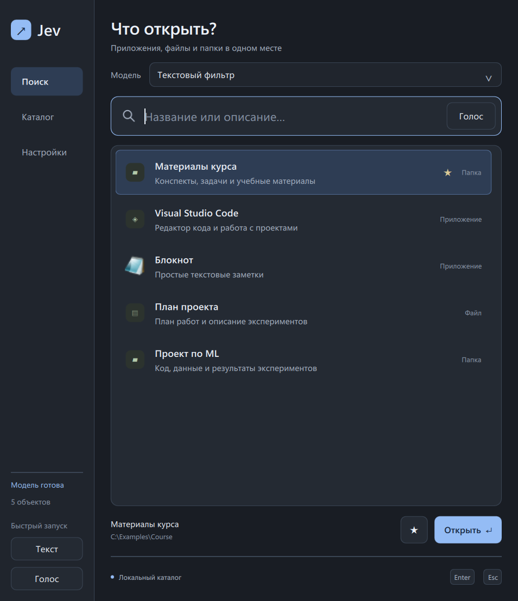
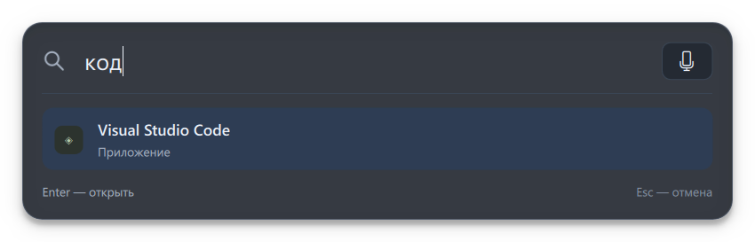

# Jev Launcher

Модульный лаунчер для Windows и основа для экспериментов с decision models. Рабочее название не привязывает проект к модели Jev.

Большое окно для поиска, каталога и настроек, отдельная компактная панель по двум горячим клавишам, трей и голосовой ввод через Whisper Large-V3. **Основная модель выбора — дообученная Laya FP32**; быстрые альтернативы — дообученная E5 и RuModernBERT. Текстовый фильтр доступен как режим без модели. Выбранная модель заранее загружается вместе с индексом каталога и остаётся в памяти до переключения или выхода.

[Короткий отчёт об итогах проекта и выборе трёх моделей](PROJECT_RESULTS_RU.md) — качество, скорость и основные выводы экспериментов. [Подбор температуры Laya](LAYA_TEMPERATURE_RU.md): T ≈ 2,49 на отдельной validation, без изменения выбранных ID.

На изображениях — демонстрационные объекты. При обычном запуске приложение собирает реальный каталог Windows.

## Запуск готовой сборки

Запустите **dist/JevLauncher/JevLauncher.exe**. Для переноса копируйте всю папку **dist/JevLauncher**, включая **_internal**. Текстовый фильтр и интерфейс работают без отдельного Python; обученные модели требуют настроенных локальных весов и CPU-сред из `models/launcher-runtime.json`. Сборка проверяется на текущем Windows 11, отдельный чистый компьютер пока не проверялся.

При первом запуске автоматически собираются приложения из меню «Пуск», Get-StartApps и стандартные папки Windows: рабочий стол, документы, загрузки, изображения, музыка, видео и домашняя папка. Учитываются перенесённые пользовательские папки. Затем каталог сразу загружается из локальной SQLite-базы. Если данные старше суток, обновление идёт в фоне: поиском можно пользоваться сразу. В «Каталоге» можно обновить данные вручную, добавить файл или папку, изменить описание и альтернативные названия, включить/отключить запись и добавить её в избранное. Деинсталляторы исключаются, одинаковые команды запуска из разных источников объединяются.

Для автоматического добавления проектов задайте корневую папку. Настройка сохраняется в базе и используется при последующих обновлениях:

~~~powershell
.\.venv\Scripts\jev-catalog.exe scan --folder-root D:\ML
~~~

Каталог включает сам корень и его непосредственные подпапки. Вложенные деревья не сканируются; скрытые и служебные каталоги (`.venv`, `node_modules`, `output`, `build`, `dist`, `tools` и другие) пропускаются. Несколько корней задаются повторением `--folder-root`.

- Обычный запуск, повторный запуск EXE и щелчок по иконке в трее открывают большое окно с разделами «Поиск / Каталог / Настройки».
- **Ctrl+Shift+Space** — компактный текстовый запуск по центру монитора с курсором. Введите запрос и нажмите Enter: открывается первый актуальный результат. Если поиск ещё идёт, приложение ждёт ответ именно на отправленный запрос.
- **Ctrl+Alt+Space** — компактный голосовой запуск с немедленной записью. Enter останавливает запись, распознаёт речь, выбирает объект и открывает его без второго подтверждения.
- Кнопка «Голос» в текстовой панели включает микрофон. «Стоп» позволяет сначала проверить текст и результат; последующий Enter открывает объект.
- После Enter панель сжимается в индикатор «Распознаю / Ищу / Открываю» и скрывается после отправки команды Windows. Ошибка разворачивает панель с доступным текстом и причиной.
- Esc, отмена или повторное нажатие текущего сочетания отменяют компактную сессию. Потеря фокуса до Enter отменяет запись и скрывает панель; после Enter обработка продолжается. Повторный Enter не запускает объект дважды; пустой запрос ничего не открывает.
- В большом окне стрелки выбирают строку, Enter и двойной клик открывают объект, Ctrl+L переводит в поиск. Закрытие большого окна оставляет приложение в трее.
- «Выйти» в трее завершает приложение и процесс модели.

Оба сочетания меняются в настройках. Существующая настройка `hotkey` сохранена для текста, `voice_hotkey` — для голоса. При конфликте показывается причина и восстанавливаются прежние рабочие сочетания. Компактное окно имеет отдельный заголовок `Jev Launcher Quick`, флаги Tool/Frameless/Always-on-top и не добавляет кнопку на панель задач. При необходимости узкое исключение GlazeWM приведено в [описании компактного запуска](QUICK_LAUNCH_RU.md).

## Запуск из исходников

Windows x64 и Python 3.12. Из корня репозитория:

~~~powershell
python -m venv .venv
.\.venv\Scripts\python.exe -m pip install -r requirements-dev.lock
.\.venv\Scripts\python.exe -m pip install --no-deps -e .
.\scripts\run.ps1
~~~

Для диагностики с выводом в терминал:

~~~powershell
.\.venv\Scripts\python.exe -m jev_launcher
~~~

Отдельный каталог для пробных запусков:

~~~powershell
.\.venv\Scripts\python.exe -m jev_launcher --data-dir artifacts\sandbox
~~~

Дополнительные параметры: --no-scan, --no-hotkey, --no-tray, --hidden. Без трея и зарегистрированной горячей клавиши закрытие окна завершает приложение.

## Голос

В настройках укажите API-ключ Groq и микрофон, затем сохраните. Альтернатива — переменная окружения GROQ_API_KEY. Сохранённый ключ защищается Windows DPAPI для текущего пользователя; переменная окружения имеет приоритет.

Кнопка «Голос» начинает запись, «Стоп» отправляет её в полный Whisper Large V3 (`whisper-large-v3`, язык `ru`). В большом окне и при остановке кнопкой текст можно проверить перед открытием. В компактной панели Enter во время записи сразу отправляет весь цикл распознавания, поиска и открытия. Запись ограничена 60 секундами; аудио остаётся в памяти. Отмена и изменение текста до отправки предотвращают применение позднего ответа.

Если ключа ещё нет, создайте его в [консоли Groq](https://console.groq.com/keys), затем вставьте в «Настройки» → «API-ключ Groq» и нажмите «Сохранить настройки». Модель доступна на Free-плане; опубликованные лимиты — 20 запросов в минуту, 2 000 запросов в день, 7 200 секунд аудио в час и 28 800 секунд в день. Точные квоты своего аккаунта проверяйте в [Limits](https://console.groq.com/settings/limits); платный план для этого сценария не требуется.

Запись с микрофона, преобразование WAV, формирование API-запроса и ошибки проверены. 5 октября 2026 года текущий клиент с полным Large V3 проверен живым запросом на синтетической фразе «Открой Excel»: получен текст «Открой Excel». Личный ключ хранится только в локальных данных с защитой DPAPI. Бесплатный доступ и квоты зависят от аккаунта: [документация Groq](https://console.groq.com/docs/speech-to-text).

## Модули и эксперименты

| Модуль | Задача |
| --- | --- |
| objects.py | Dataclass-записи и идентичность способа запуска |
| catalog.py | SQLite, постоянные ID, обновление и пользовательские поля |
| discovery.py + resources/discover.ps1 | Сбор источников Windows |
| search.py | Прозрачный текстовый фильтр |
| launch.py | Открытие сохранённого объекта по ID |
| speech.py | HTTPS-запрос распознавания; не зависит от Qt |
| audio.py | Запись микрофона и преобразование аудио в памяти |
| config.py, hotkey.py, icons.py | Настройки/ключ, горячая клавиша, иконки |
| jobs.py, controller.py | Фоновые задачи и связь логики с Qt |
| quick.py + ui/Quick.qml | Отдельная компактная сессия, top-1, Enter, отмена и индикатор этапов |
| app.py + ui/ | Сборка приложения, трей и QML-интерфейс |
| cli.py | Каталог без окна и открытия программ |

Полный доступный каталог для модели отдаёт **Catalog.model_catalog()**. Он не зависит от фильтра интерфейса и содержит ID, название, тип, описание и альтернативные названия. Пути и команды остаются локально.

~~~powershell
.\.venv\Scripts\jev-catalog.exe export --output artifacts\catalog.json
.\.venv\Scripts\jev-catalog.exe search "редактор кода"
.\.venv\Scripts\jev-catalog.exe --db artifacts\sandbox\catalog.sqlite3 scan
~~~

Экспорт включает хеш снимка для воспроизводимых экспериментов и не запускает программы. Подробности: [архитектура](ARCHITECTURE.md), [эксперименты](EXPERIMENTS.md), [исходный план](../MVP_PLAN.md).

## Датасеты для сравнения моделей

Подготовлены **launcher-v1: 400 авторских текстовых запросов** — по 200 на реальном и полностью вымышленном каталогах. В каждом каталоге 177 объектов; в каждом наборе 50 validation и 150 отложенных test. Все запросы требуют открытия одного однозначно заданного объекта; измеряем top-1 accuracy выбранного ID. Сложность создают перефразы, опечатки, раскладка, похожие варианты и явные поправки выбора. Уточнения, отказы и аудио отложены до следующих версий.

Переносимый вымышленный набор лежит в **data/benchmarks/launcher-v1/synthetic**; реальный — в игнорируемом **artifacts/benchmarks/launcher-v1/real**. Разметка прошла второй авторский просмотр; независимой человеческой проверки пока нет. Состав, формат и правила использования: [описание набора](../data/benchmarks/launcher-v1/README.md).

Отдельно подготовлен **launcher-basic-v1: ещё 400 обычных запросов пользователя**, по 200 на тех же каталогах, с разбиением 50 validation / 150 test. Названия, разговорные варианты, описания назначения и небольшие опечатки: без намеренных ловушек. Каталоги, цели и группы согласованы со сложным launcher-v1; точность считать отдельно для каждого профиля. Файлы и протокол: [базовый набор](../data/benchmarks/launcher-basic-v1/README.md).

Третий профиль [launcher-asr-v1](../data/benchmarks/launcher-asr-v1/README.md) содержит **400 настоящих расшифровок шумной TTS-речи через Groq ASR**: по 200 на тех же каталогах, 50 validation / 150 test. Исходные фразы и цели согласованы с базовым профилем; сохранены WAV, параметры шума и ответы API. Расшифровки не исправлялись; потеря различающего смысла отмечена отдельно. Оценивать чистый и распознанный текст раздельно. Записи человеческого голоса относятся к следующей версии.

Новый независимый [launcher-independent-v1](../data/benchmarks/launcher-independent-v1/README.md) содержит **200 написанных с нуля запросов на новом каталоге из 177 объектов**: 50 validation / 150 test, 40 разных целевых групп. Сохранены две связанные версии — чистый текст и реальные расшифровки новых нейронных TTS-записей с мягким шумом через полный Whisper Large V3. Проверены пересечения со всеми прежними оценочными и обучающими наборами, включая `launcher-transfer-v1`; запросы, объекты, названия и записи не повторяются. Этот набор предназначен для отдельной оценки, а не обучения.

Оценка **всех восьми вариантов** на нём завершена. Дообученный Kev, выбранный ранее по обычной validation, получил **149/150 clean и 146/150 ASR на test**; исходный Kev — 143/150 в обоих представлениях, E5 — 143/150 и 136/150. [Полный отчёт](INDEPENDENT_MODEL_EVALUATION_RU.md) содержит отдельные validation/test результаты, статистику, ошибки и точный объём CPU-сверки. Новые данные не выбирали веса или пороги; скорость и GUI-интеграция этим сравнением не подтверждены.

Для обучения подготовлен [launcher-train-v1](../data/training/launcher-train-v1/README.md): **5 664 синтетических примера из 708 исходных запросов** на восьми новых каталогах по 177 объектов. Все ответы — один `open(object_id)`; отложенные запросы и целевые объекты исключены из обучения. Общий формат находится в data/training, экспорт для Kev — в artifacts/training. Полный экспорт проверен токенизатором Qwen3.5-4B-Base: для обучения в Kev требуется `--max_state 16384`. Проверка разметки авторская.

Это требование контекста относится к экспорту со всеми 177 вариантами. Текущие Kaggle-запуски Nano/Laya/Kev учатся выбирать из закреплённых E5 top-20. У Kev-0.8B этот native input проверен на всех 22 656 train и 150 validation строках: максимум 1 099 / 640 токенов при бюджете 8 192, без обрезки запроса и вариантов.

Отдельный обучающий профиль [launcher-stt-train-v1](../data/training/launcher-stt-train-v1/README.md): **16 992 примера с искусственными ошибками STT**, три версии каждой исходной обучающей фразы. Есть фонетические замены, разделение/слияние слов, запись имён в разных алфавитах, числа и сокращения словами, повторы и составные искажения. Сохранены исходный текст, операции и единственная цель. Все три профиля оценки защищены от пересечений; реальные ASR-расшифровки оценки в обучение не включены. Общий формат и готовый Kev-экспорт сохранены отдельно.

Для **Nano-Jev v0.1** завершены два приватных Kaggle-ноутбука: смесь с первого шага и чистый старт с последующей смесью. В обоих один проход по тем же 22 656 примерам, одинаковые исходные веса и 1 416 обновлений. После скачивания веса проверены на 300 локальных validation-примерах. На реальном каталоге смесь получила **86% / 70% / 62%**, чистый старт — **88% / 70% / 68%** для basic / difficult / ASR. На синтетическом каталоге E5 без Nano-Jev пока точнее обеих обученных моделей. [Протокол и полный отчёт](KAGGLE_NANOJEV_FINETUNING.md) содержит отдельные результаты всех профилей, проверки и ограничения первого эксперимента.

~~~powershell
.\.venv\Scripts\python.exe scripts\validate_benchmark.py data\benchmarks\launcher-v1\synthetic artifacts\benchmarks\launcher-v1\real
~~~

Команда проверяет оба набора и согласованность разбиений между ними. Для проверки только переносимых данных укажите одну директорию synthetic. Она не вызывает модели и не открывает объекты.

## Проверки и сборка

Результаты и границы проверки: [VALIDATION.md](VALIDATION.md).

~~~powershell
.\.venv\Scripts\python.exe -m pytest -q
.\.venv\Scripts\ruff.exe check src tests scripts
.\scripts\build.ps1
~~~

Проверка упакованного приложения в отдельном каталоге:

~~~powershell
.\.venv\Scripts\python.exe scripts\windows_smoke.py --exe dist\JevLauncher\JevLauncher.exe
~~~

Отдельная проверка реального открытия тестовых объектов:

~~~powershell
.\.venv\Scripts\python.exe scripts\windows_smoke.py --open-objects
~~~

Последняя команда открывает Блокнот, калькулятор, временную папку, текстовый файл и ярлык; закрывает только новые окна, соответствующие тестам. Отчёт сохраняется в artifacts/windows-smoke.

Превью на вымышленных данных: **python scripts/capture_demo.py**. Программы при этом не запускаются.

## Данные и ограничения

Подробный учебный разбор устройства приложения, моделей, данных и обучения: [проект и обучение](PROJECT_AND_TRAINING_RU.md). [Laya: результаты чистого старта и проверки переноса](KAGGLE_LAYA_FINETUNING.md); [Kev: чистое начало и validation stopping](KAGGLE_KEV_FINETUNING.md). Обучение всех выбранных моделей завершено.

[Квантование Laya и повторные замеры CPU](LAYA_QUANTIZATION_RU.md): отдельная INT8-копия проверена на 800 представлениях. При одинаковом весе десяти сценариев accuracy 87,85% →78,75%; пользователь принял этот компромисс. Два полных замера E5→ID дали медианы 435 и 647 мс — устойчивый целевой лимит 500 мс пока не подтверждён.

[Дообученный русский RuModernBERT](KAGGLE_MODERNBERT_FINETUNING.md): выбран шаг426 из852, среднее десяти сценариев71,50%→84,90%. Два полных warm CPU400 прогона: медиана118/148мс,p95156/184мс, все800 измерений<500мс. На текущем real-каталоге Nano всё ещё точнее; reranker доступен в списке моделей приложения.

[Продолжение обучения Nano](KAGGLE_NANOJEV_CONTINUATION_RU.md) завершено 7 октября: 426 дополнительных обновлений с lr1e-5, остановка после трёх validation NLL без улучшения. Выбраны прежние веса, среднее десяти сценариев 79,05%. Полные warm CPU400 повторы: медиана 387/408 мс, p95 443/472 мс, 12 из 800 ответов дольше 500 мс. Последние веса проверены отдельно: 79,60% среднего, но real-каталог 74,00% вместо 75,33% и NLL хуже; выбранный checkpoint остаётся прежним.

[Итог всех обученных моделей с приоритетом сложного STT](FINAL_MODEL_COMPARISON_RU.md): на старом шумном ASR среднее двух каталогов — Kev 87%, Laya FP32 80%, Nano 72%, RuModernBERT 71%, Laya INT8 64%. Отдельно приведены новый Large‑V3 ASR, выбранные веса и скорость с границами каждого замера. Сводка заново проверена по 4800 сохранённым предсказаниям. Для учебного приложения выбрана Laya FP32, шаг 568.

[RuBERT-tiny2 с новой decision-головой](KAGGLE_RUBERT_TINY2_CHOICE_RU.md) проверен 8 октября: 568 обновлений, выбраны веса 142. На известных данных — 25% старого шумного STT и 26,25% среднего десяти сценариев. Полные CPU400×2 замеры дали медиану 66,30/66,53 мс, p95 99,05/102,81 мс. Это быстрый, но слабый по качеству результат одного рецепта; основная Laya и доступные быстрые варианты сохраняются.

[Модели в приложении и настройка окружения](APPLICATION_MODELS_RU.md); [реестр всех экспериментов](EXPERIMENT_REGISTRY.json). Файл `models/launcher-runtime.json` подключает существующие веса и CPU-среды; сборка Qt использует эти локальные пути. Быстрые варианты выбираются в списке «Модель».

База, настройки и лог находятся в **%LOCALAPPDATA%/JevLauncher**. Переопределение — --data-dir или JEV_LAUNCHER_DATA_DIR. Личные каталоги, аудио, модели, ключи и результаты запусков исключены из Git.

Сканирование не гарантирует обнаружение каждого portable-приложения. Варианты запуска с разными аргументами или рабочими папками сохраняются отдельно. Каталог можно фильтровать по подстроке; поиск использует выбранную модель и выполняется в фоне. Обучение и оценка выполняются отдельно от запуска объектов.
