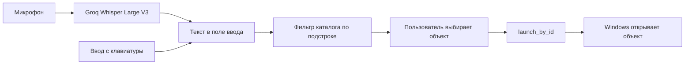
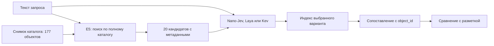
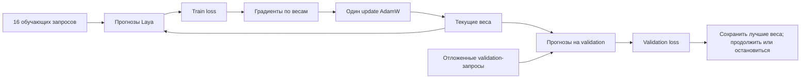
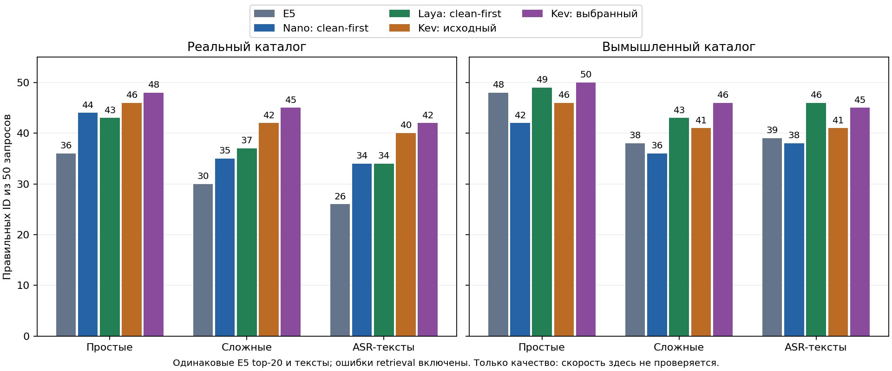
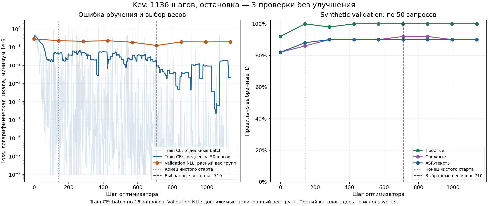
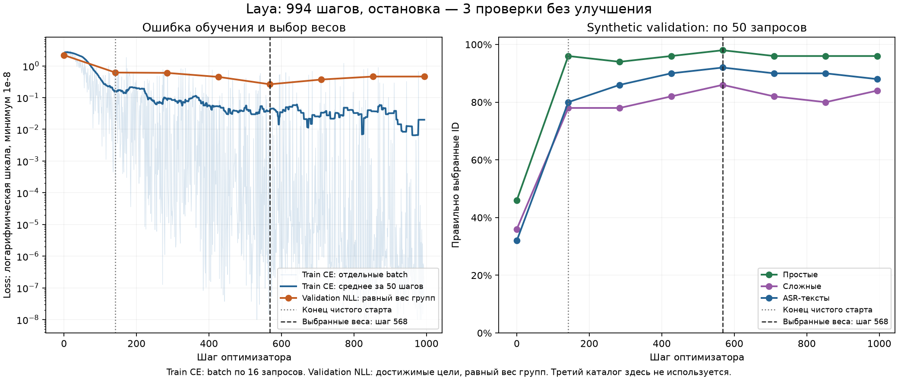
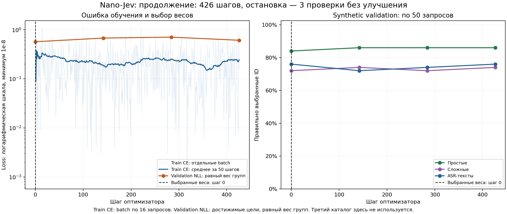
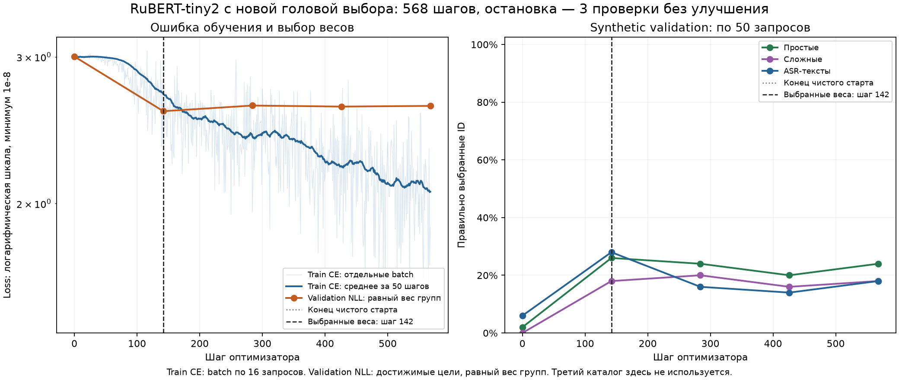
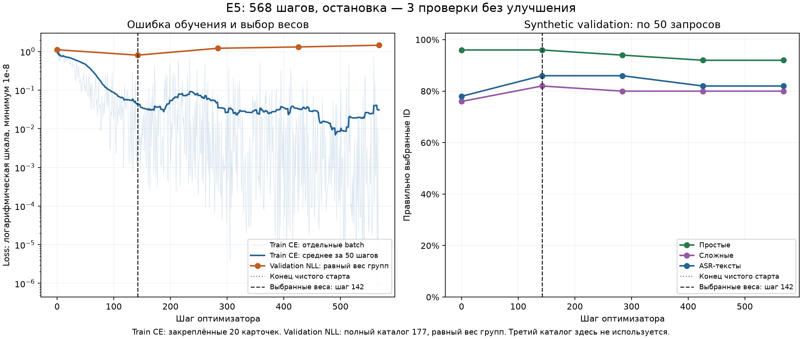

# Устройство Jev Launcher и обучение моделей выбора

Historical experiment record. Paths under `artifacts/` refer to local files; published predictions and ledgers are in [public evidence](../results/README.md).

Этот разбор относится к состоянию проекта 6 октября 2026 года. Он связывает работающий Windows launcher, экспериментальный поиск и наши Kaggle-запуски. В нём отделены реализованное поведение, измеренные результаты и следующие проверки.

Дополнение 7 октября: все выбранные обучения завершены, Laya FP32 шага 568 стала основной моделью учебного приложения. В поиске появился выбор быстрых альтернатив. Разделы с прежним ручным фильтром описывают исходную архитектуру; актуальное подключение — в разделе 21 и [APPLICATION_MODELS_RU.md](APPLICATION_MODELS_RU.md). Итоги и источники сохранены в [реестре экспериментов](EXPERIMENT_REGISTRY.json).

Дополнение 8 октября: обучена E5, добавлены автоматические описания и завершена парная проверка замены E5 перед Laya. Общего выигрыша цепочки нет:80%→78% старого STT,88,15%→87,95% macro10. Сохраняется исходная E5 → выбранная Laya FP32. Обученная E5-only остаётся отдельным сильным быстрым вариантом по измерениям; её GUI-профиль не добавлялся. Температура Laya после обучения не подбиралась, T=1; изменение её после forward меняет уверенность, а не выбранный ID. [Точный протокол и результаты](E5_LAYA_PIPELINE_RU.md), [ответы на вопросы 25 и 26](LEARNING_ANSWERS_RU.md).

Чтобы изучить весь проект, будем связывать объяснения с одним запросом и конкретным кодом, а затем обсуждать твоё понимание. Последовательность чтения:

1. Разделы 1–5: запрос, GUI, каталог, E5, выбор позиции и открытие по ID. Здесь видно, что уже работает в приложении и что пока существует в эксперименте.
2. Разделы 6–9: устройство моделей, происхождение примеров и подготовка двадцати кандидатов.
3. Разделы 10–11: один forward, loss, градиенты и обновление весов. После этого можно читать цикл в `scripts/train_laya_kaggle.py`.
4. Раздел 17: фактическое прохождение всех четырёх обучений, графики и журналы. Разделы 12–14 поясняют выбранный порядок данных и остановку.
5. Разделы 15–16: как подтвердили сохранённые веса, качество на новых запросах и скорость; что осталось до использования в GUI.
6. Раздел 18: что меняет квантование, как считать среднее качество и почему замер скорости надо повторять.

Для текущего вопроса о ходе обучения начни с раздела 17 и [графика Laya](../assets/experiments/laya-learning-curves.png). [График Kev](../assets/experiments/kev-learning-curves.png) показывает второй завершённый запуск. Эти графики построены из журналов выполненных обновлений и проверок, а не из плана эксперимента.

**1. Какую задачу мы решаем.**

Пользователь просит: «Открой редактор кода», «Не приложение, а папку проекта», «Запусти обычный блокнот, без плюс-плюс». Нужно выбрать существующий объект из каталога. Формально вход — запрос `q` и каталог `C`, выход — `object_id` одного объекта из `C`. В текущем benchmark каждый запрос имеет одну размеченную цель и действие `open`.

Это классификация с вариантами ответа, которые меняются между запросами и компьютерами. У нас нет фиксированной головы «класс 0 = Chrome, класс 1 = Telegram» на все случаи. Модель читает описания предложенных вариантов и выбирает позицию. Python сопоставляет позицию с настоящим ID. Добавление нового объекта не требует добавлять нейрон в голове классификатора; качество на новых объектах всё равно нужно проверять.

Например, в сокращённом учебном списке запрос «Открой программу для таблиц» сопровождается тремя вариантами: `o0` — Writer, приложение для текстовых документов; `o1` — Calc, приложение для электронных таблиц; `o2` — План.xlsx, файл с таблицей. Laya видит запрос, эти тексты и номера вариантов. Настоящие IDs остаются в отдельном списке приложения: `[id-17, id-92, id-38]`. Выбор `o1` означает позицию 1; наш код возвращает `candidate_ids[1]`, то есть `id-92`. На обучении правильный `id-92` также преобразуется в позицию 1 для loss. Это иллюстрация формата, а не измеренный запрос benchmark.

В Laya один общий scorer преобразует представление каждого маркера в оценку: он не имеет отдельного класса для каждого ID каталога. Transformer позволяет представлению маркера учитывать запрос и текст кандидата. При замене Calc на новое приложение с описанием «работа с электронными таблицами» модель может применить изученное сопоставление смысла, хотя название и ID новые. Если описания двух объектов одинаковы, а запрос их не различает, отсутствующую информацию нельзя восстановить одним обучением.

В текущем наборе нет полноценных сценариев «нужного объекта нет», «запрос неоднозначен», «ничего не открывай». Высокая точность на однозначном `open` ещё не означает, что автоматическое открытие готово для всех пользовательских ситуаций.

Пользователь предложил при неразличимых вариантах показывать выбор в приложении. Описания поступают из источников каталога; ручное переписывание всех карточек не является обязательным условием работы. Названия, тип и aliases иногда добавляют недостающий сигнал, но полностью отсутствующее намерение нельзя восстановить из текста. Модель не обязана давать ровно равные softmax-вероятности, а высокая вероятность может сопровождать ошибку. Текущая разметка с одной целью поощряет выделение одного кандидата; обучение и проверка неоднозначности, калибровка и правило показа вариантов остаются отдельным продуктовым этапом.

**2. Что сейчас работает в приложении.**

Основной checkout находится в `D:\ML\petprodj\jev_pet`. Интерфейс написан на Python, PySide6 и QML. `controller.py` связывает окно с каталогом, записью речи и фоновыми задачами. `search.py` содержит текущий текстовый фильтр. Голосовой запрос превращается в текст через `speech.py`; действующая модель распознавания — `whisper-large-v3` в Groq.

После распознавания приложение применяет тот же фильтр, что при вводе с клавиатуры. Дообученные Nano-Jev, Laya и Kev пока не подключены к выбору в GUI. Их результаты получены в отдельных экспериментах.

Распознавание речи и модель выбора отвечают за разные ошибки. Whisper может услышать «Ненорон» вместо «Ненарон». Модель выбора получает уже этот текст и должна сопоставить его с каталогом. Наше обучение не изменяет Whisper и не получает аудио; оно меняет обработку текстового запроса после распознавания.

**3. Зачем нужны SQLite, каталог и граница открытия.**

`catalog.py` хранит найденные приложения, файлы и папки в SQLite. У объекта есть ID, название, тип, описание, псевдонимы, признак доступности и сведения о запуске. Сканирование ищет источники Windows и настроенные папки проектов. Пользовательские правки сохраняются как overrides; повторный скан не должен их стирать. Ошибка одного источника не означает, что все его старые объекты исчезли.

WAL позволяет читать каталог во время фонового обновления. Окно сначала использует сохранённые записи. Успешный полный скан имеет отдельную дату; обычный срок свежести — 24 часа. Qt-задачи выполняют сканирование, распознавание и открытие в фоне, чтобы интерфейс не ждал этих операций. Поздний ASR-ответ проверяется по номеру запроса: если пользователь уже изменил текст, старую расшифровку нельзя вставлять поверх нового ввода.

`Catalog.model_catalog()` возвращает весь включённый и доступный набор объектов. `Controller.results` возвращает текущую экранную выборку. Если передавать модели только `results`, простой подстрочный фильтр заранее выбросит объекты, которые семантическая модель могла бы понять. Поэтому модель должна получать полный модельный каталог, а retrieval — сокращать именно его.

Метод `CatalogObject.for_model()` оставляет ID, название, тип, описание и aliases. Пути, аргументы и способы открытия остаются в приложении. `launch_by_id` загружает существующий объект по ID, проверяет доступность и передаёт сохранённую команду Windows. Для executable используется список аргументов и `shell=False`.

Из этого следует конкретное свойство: текст запроса и ответ нейросети не исполняются как shell-команда. Ошибка выбора всё ещё может привести к открытию неверного объекта. Ограничение пространства ответов не гарантирует правильность намерения пользователя.

**4. Где находится ML-часть.**

Экспериментальная ветка находится в worktree `C:\Users\matva\.codex\worktrees\c58b\jev_pet`, ветка `codex/local-e5-small`. Worktree — отдельная рабочая папка того же Git-проекта. Изменения в ней не становятся автоматически изменениями основной папки. В ней находятся `semantic.py`, адаптеры моделей, закреплённые веса и прежние отчёты. Другой worktree `f607` содержит работу над лексическими baseline.

Наши новые скрипты обучения, ноутбуки и документация находятся в основном checkout на D:. Тяжёлые файлы запусков лежат в `artifacts/kaggle`. Веса и личные каталоги не нужно добавлять в Git. Исходный notebook и скрипт описывают эксперимент; checkpoint и журналы показывают, что реально получилось при выполнении.

При измерении качества цепочка заканчивается оценкой ID. Приложения не открываются. Подключение результата к `launch_by_id` — отдельный продуктовый этап после проверки качества и времени.

**5. Что делает E5 и почему он ограничивает качество.**

E5 кодирует текст запроса и текст каждого объекта в вектор из 384 чисел. В `passage_text` описание объекта собирается из названия, типа, description и aliases. Запрос получает префикс `query:`, объект — `passage:`. В `semantic.py` используется закреплённый `multilingual-e5-small`, ONNX и CPU.

Токенизация превращает текст в последовательность номеров токенов. Токен не обязан совпадать со словом: редкое название может состоять из нескольких частей. Encoder строит представление каждого токена. E5 усредняет представления с учётом attention mask и нормирует результирующий вектор. Если `u` и `v` имеют длину 1, их скалярное произведение `uᵀv` равно косинусной близости. Чем выше близость, тем выше кандидат в списке.

Вектор каталога можно сохранить и повторно использовать, пока его содержимое и версия модели не изменились. Вектор нового запроса вычисляется отдельно. E5 top-20 оставляет 20 из 177 объектов. Это уменьшает работу более дорогой модели выбора.

`Recall@20` — доля запросов, для которых правильный объект попал в эти 20. `Top-1 accuracy` — доля запросов, где итоговый выбор действительно правильный. Для такой цепочки:

`accuracy = recall@20 × P(правильный выбор | цель есть среди кандидатов)`.

На нашей real ASR validation E5 покрывает 44 из 50 целей: recall 88%. Даже идеальная модель выбора на этом shortlist получит максимум 44/50. Nano-Jev clean-first выбрал правильно 34/50: общая точность 68%, условная точность среди достижимых целей 34/44 ≈ 77,3%. Шесть retrieval misses нельзя исправить обучением второй ступени на неизменном shortlist.

E5-only тоже является самостоятельным baseline: выбрать первый объект по его близости. Если модель выбора ухудшает этот результат, дополнительная ступень пока не приносит пользы на соответствующем наборе.

**6. Что такое encoder, attention и голова выбора.**

Начальное представление токена берётся из обучаемой таблицы embeddings. Это не вектор E5 для всего запроса: здесь каждому токену соответствует собственный вектор. Transformer меняет эти векторы через attention и feed-forward слои, residual connections и нормировку.

В упрощённой записи attention вычисляет `Q = HW_Q`, `K = HW_K`, `V = HW_V`, затем `softmax(QKᵀ/√d + mask)V`. Матрица `H` содержит представления токенов. Строка softmax задаёт, какую информацию один токен берёт у остальных. Mask определяет разрешённые связи. Несколько attention heads дают несколько таких способов сопоставления, а слои позволяют строить более сложные признаки.

Bidirectional encoder использует контекст с обеих сторон токена. Например, смысл «блокнот» может зависеть от следующего «без плюс-плюс». Causal модель ограничивает обычное внимание к последующим токенам; её формат входа и ветки вопросов должны учитывать это. Нельзя переносить упаковку входов между архитектурами только потому, что обе возвращают JSON.

Голова выбора — небольшая обучаемая часть, которая превращает представления encoder в оценки вариантов. Encoder и голова вместе определяют результат. У Nano и Laya мы обновляем encoder и голову выбора; у Kev базовые веса заморожены, обучаются LoRA и pointer head. Во всех случаях начинаем с готовых весов, а не обучаем языковую систему с нуля.

**7. Чем отличаются наши модели.**

| Модель | Представление входа | Как получается выбор | Роль сейчас |
| --- | --- | --- | --- |
| E5 | Запрос и объект кодируются отдельно | Близость векторов | Retrieval и самостоятельный baseline |
| Nano-Jev v0.1 | 20 независимых пар «запрос + описание одного варианта» | Один scalar на пару, softmax по 20 scalars | Два завершённых fine-tune запуска |
| Laya multilingual | Запрос и все варианты в одной последовательности | Оценка `[MASK]`-маркеров вариантов | GPU, скачивание, 300 локальных строк и третий каталог проверены |
| Kev-0.8B | Общий state и отдельные ветки вопросов | Родная pointer head | Выбран шаг 710; полный GPU/CPU-аудит 300 локальных строк пройден |

Nano-Jev v0.1 использует MiniLM с шестью слоями, hidden size 384 и примерно 22,7 млн параметров. Описание и запрос входят в одну пару, поэтому признаки пары могут взаимодействовать внутри encoder. Но разные варианты не читают друг друга; их оценки сравниваются в конце.

Laya использует mmBERT-base с 22 слоями, hidden size 768, двумя дополнительными transformer слоями и scorer для маркеров. В загруженном native model 321 908 995 параметров. Шаблон выглядит так: `[CLS] choice instructions [SEP] [MASK] o0: описание ... [MASK] o19: описание [SEP] запрос [SEP]`. Представление каждого маркера зависит от общей последовательности. Это отличается от 20 независимых пар. Официальное устройство описано в [карточке Laya](https://huggingface.co/convaiinnovations/laya-multilingual).

Число параметров — количество обучаемых чисел, а не число правил или примеров. Большая модель может иметь лучшие языковые признаки и одновременно хуже подходить конкретной задаче без адаптации. Наши измерения нужны именно потому, что размер и сходство интерфейса не выбирают победителя.

Kev использует другую авторскую реализацию с Qwen3.5, LoRA и pointer head. LoRA представляет обновление большой матрицы как произведение двух меньших `ΔW = BA`; это сокращает число обучаемых параметров. Совпадение типов `choice/noul/score` с Jev не доказывает совпадение внутренних архитектур. Kev остаётся кандидатом; прежний строгий CPU-лимит 3 секунды для полного запроса им не пройден.

Nano-Jev и Jina Nano — разные модели. Jina в проекте относится к поиску кандидатов; Nano-Jev в этом эксперименте выбирает из shortlist.

**8. Что находится в датасете.**

`launcher-train-v1` содержит 5 664 базовые строки на восьми вымышленных каталогах по 177 объектов. Они происходят из 708 seed-запросов и 117 сценарных семейств. `launcher-stt-train-v1` содержит ещё 16 992 строки: три искусственно искажённые версии каждой базовой строки. Всего — 22 656 обучающих строк.

«Clean» здесь означает исходную обучающую фразу до дополнительных STT-искажений. Она уже может содержать намеренную опечатку или уточнение нужного варианта. В текущем исходном train нет отрицаний и самопоправок; они относятся к difficult evaluation. Реальный пример базовой строки: «Запусти Дламера», цель — вымышленная «Доламера». Пример simulated STT: «Открой приложение Nenoron», исходный вариант — «Открой приложение Nenaron».

В проекте есть два уровня представления данных. Общий экспорт Kev в `artifacts/training` содержит все 177 объектов каталога; его прежняя tokenizer-проверка требовала контекст 16 384. Для текущего эксперимента мы подготовили отдельные `prepared-train.jsonl` и `prepared-validation.jsonl` с 20 кандидатами E5. Оценке разрешено ошибиться на этапе retrieval; train-only вставки цели явно учтены. Именно эти закреплённые shortlist получают все три модели. Поэтому текущему Kev-0.8B хватает бюджета 8 192: реально train использует максимум 1 099 токенов, validation — 640. Ограничение старого полного экспорта не является параметром нынешнего запуска.

Число строк не равно числу независимых задач. Несколько фраз могут быть вариациями одного seed; каталоги подставляют другие имена в ту же задачу; STT меняет форму уже существующей фразы. Поэтому восемь миров и тысячи вариантов не дают автоматически тысячи независимых сценариев.

`group_id` связывает родственников. Разделение train и validation по случайным строкам могло бы положить исходную фразу в train, а почти её копию в validation. Тогда модель показывала бы узнавание уже встреченного шаблона. Наши validators проверяют пересечения групп, идентификаторов и запросов с отложенными наборами.

На вход модели поступают только запрос и метаданные кандидатов. `expected_object_id`/`target` используется как правильный ответ для функции потерь. `rationale`, происхождение строки и операции искажения — данные для проверки и автора, а не подсказки модели. Если дать ей rationale с названием цели, результат обучения будет вводить в заблуждение.

**9. Почему обучение и оценка по-разному обращаются с shortlist.**

Для обучения модель выбора должна увидеть правильный вариант среди кандидатов: иначе cross-entropy по одному из 20 вариантов не имеет правильного индекса. В замороженных обучающих списках цель пришлось добавить в пяти базовых и 46 STT-строках. Это записано в manifest.

При оценке правильную цель нельзя подставлять. Иначе метрика притворится, что retrieval никогда не ошибается. Поэтому validation сохраняет исходные E5-кандидаты, а промахи входят в знаменатель общей точности как ошибки. NLL модели выбора для stopping считается только там, где цель достижима; candidate recall сообщается отдельно.

Порядок кандидатов заранее перемешан для каждой строки и одинаков для запусков. Иначе модель могла бы научиться постоянно выбирать первую позицию, подражая E5 или использовав порядок как подсказку. Замороженный порядок делает сравнение воспроизводимым; устойчивость к новым перестановкам остаётся отдельным свойством для проверки.

**10. Что означает «модель обучается».**

Пусть модель выдала двадцать чисел `z₀, …, z₁₉` — logits. Это оценки, которые могут быть отрицательными и не обязаны суммироваться в единицу. Softmax превращает их в положительные числа с суммой 1:

`pᵢ = exp(zᵢ) / Σⱼ exp(zⱼ)`.

Для одного правильного индекса `y` cross-entropy равна `L = −log(p_y)`. В игрушечном примере с тремя вариантами logits `[0, 1, 2]` дают приблизительно `[0,090; 0,245; 0,665]`. Если правильный вариант третий, loss около 0,408. Если первый — около 2,408. Уверенная ошибка наказывается сильнее: вероятность правильного ответа 0,01 даёт loss около 4,605.

Accuracy смотрит только на индекс максимума. Loss учитывает и распределение оценок. Если правильный вариант уже первый, увеличение его вероятности может уменьшить loss без изменения accuracy. Поэтому оба показателя нужны, и выбор лучшего NLL не гарантирует лучшую accuracy в каждом профиле.

Backpropagation вычисляет, как каждое обучаемое число повлияло на loss. Для logits производная имеет вид `∂L/∂zᵢ = pᵢ − 1[i=y]`. Для правильного варианта она отрицательна, для остальных положительна. Дальше chain rule переносит влияние через голову и encoder на их параметры. Оптимизатор меняет параметры в направлении уменьшения ошибки.

Loss — одно число; направление для каждого веса задаёт его производная. Простейший шаг gradient descent записывается как `w_new = w_old − η·∂L/∂w`, где `η` — learning rate. Наш AdamW дополнительно сглаживает и масштабирует градиенты и применяет weight decay; формула выше объясняет основу, а не все его вычисления.

Для одного choice-запроса связь можно разобрать точнее. Пусть `z_i` — score варианта до softmax, `p_i = exp(z_i) / sum_j exp(z_j)`, а `t` — индекс правильного варианта. Тогда `L = −log(p_t) = log(sum_j exp(z_j)) − z_t`. Производная по каждому score равна `∂L/∂z_i = p_i − 1[i=t]`. PyTorch вычисляет cross-entropy устойчиво через log-sum-exp, без необходимости сначала округлять вероятности и брать их логарифм вручную.

В учебном примере из трёх вариантов вероятности равны `[0,2; 0,7; 0,1]`, а правильный вариант — первый. Loss равен `−log(0,2) ≈ 1,609`, градиенты по scores — `[-0,8; +0,7; +0,1]`. Если бы мы обновляли сами scores простым gradient descent, первый вырос бы, остальные снизились. В настоящей модели меняются общие параметры: `∂L/∂θ = sum_i (∂L/∂z_i)(∂z_i/∂θ)`. Autograd проходит через projections, attention и остальные операции, чтобы получить производную для каждого разрешённого к обучению параметра. Это учебные числа, а не запись из нашего test.

Одни параметры участвуют в прогнозах на многих запросах и вариантах. Поэтому улучшение одного примера может улучшить или ухудшить другие; мы не редактируем отдельную сохранённую вероятность. У Kev эти градиенты обновляют LoRA и pointer head, у замороженной базы значения сохраняются. Для нашей one-row train-проверки loss 0,090289 соответствует вероятности правильного варианта примерно `exp(−0,090289) ≈ 0,914`; это интерпретация одного forward, без вывода об общей точности.

В validation-ветке нет обратного распространения или optimizer update. Она влияет на выбор сохранённого состояния. Третий test-каталог подключается после завершения этого выбора.

В нашем коде основная операция — `cross_entropy(logits.float(), correct_index)`. У Nano logits предварительно собираются из двадцати scalar-оценок пар. У Laya их возвращает родная модель по двадцати маркерам. Ни Python, ни loss не записывают правило «Дламера значит Доламера» в явную таблицу; обновляются признаки, которые должны помогать и на других примерах.

**11. Один шаг, batch, learning rate и checkpoint.**

Batch — несколько запросов, по которым усредняется градиент. Microbatch — часть, которую GPU обрабатывает за один forward/backward. Накопление градиентов позволяет получить effective batch 16, даже обрабатывая по одному запросу. В Laya каждый micro-loss делится на число запросов в группе; после 16 backward выполняется одно обновление AdamW. У Nano на GPU было четыре microbatch по четыре запроса.

Optimizer step — обновление весов, а не обработка одной строки. `22 656 / 16 = 1 416` updates составляют один полный проход. Epoch — такой проход по выбранному датасету. Если early stopping остановит Laya раньше, часть строк не будет использована; журнал должен отражать реальную экспозицию, а не максимальный план.

Learning rate задаёт масштаб обновления. AdamW дополнительно использует накопленные оценки градиентов и отдельное затухание весов. Weight decay 0,01 — небольшая регуляризация, а не вероятность удаления параметра. Warmup повышает lr постепенно в начале; linear decay снижает его к концу бюджета. Gradient clipping ограничивает норму общего градиента, чтобы один тяжёлый batch не дал слишком крупное обновление.

Checkpoint — сохранённые веса, конфигурация и токенизатор, которые можно загрузить заново. Это отличается от gradient checkpointing: последний временно не хранит часть activations и вычисляет их повторно при backward, уменьшая GPU-память за дополнительную работу. Два значения слова checkpoint не относятся к одному механизму.

Mixed precision использует разные числовые форматы для разных операций. В Laya training применяется FP16 autocast, а параметры и состояния optimizer остаются FP32. GradScaler увеличивает loss перед backward, чтобы мелкие градиенты не исчезали в FP16, затем снимает масштаб перед clipping/step. Валидация выполняется FP32. Это соответствует механике [PyTorch AMP](https://docs.pytorch.org/docs/2.11/amp.html).

Seed закрепляет источники случайности для порядка примеров и Torch. Он делает эксперимент воспроизводимее, но не оценивает разброс между обучениями. Проверка одного seed не показывает, повторится ли небольшое преимущество при другом порядке и dropout.

**12. Что показал завершённый Nano-Jev эксперимент.**

Мы сравнили две гипотезы пользователя. В mixed все строки перемешаны с первого шага. В clean-first первые 2 272 строки — исходные, а оставшиеся 3 392 исходные и 16 992 STT-строки перемешаны. Во втором запуске чистые строки не повторяются сверх первого: мультимножество примеров и 1 416 updates совпадают. Меняется только порядок.

| Каталог / профиль | Исходный Nano | E5-only | Mixed | Clean-first |
| --- | ---: | ---: | ---: | ---: |
| Реальный / basic | 38% | 72% | 86% | 88% |
| Реальный / difficult | 32% | 60% | 70% | 70% |
| Реальный / ASR | 20% | 52% | 62% | 68% |
| Вымышленный / basic | 8% | 96% | 84% | 84% |
| Вымышленный / difficult | 10% | 76% | 74% | 72% |
| Вымышленный / ASR | 4% | 78% | 74% | 76% |

В каждой ячейке те же 50 validation-запросов. Fine-tuning сильно улучшил исходный Nano во всех шести поднаборах. На реальном каталоге обе обученные модели обошли E5-only. На вымышленном E5-only остаётся точнее. Усреднять это в одно красивое число было бы потерей существенной информации.

Разница 62% → 68% в real ASR — три дополнительных успеха. Clean-first исправил четыре ошибки mixed и потерял один его успех. Это paired сравнение: важны изменения на одних и тех же запросах.

Пятьдесят строк в поднаборе принадлежат 13 группам. Bootstrap поэтому пересэмплирует целые группы, а не независимо каждую строку. Полученный 95% интервал разницы clean-first минус mixed включает ноль: от 0 до примерно 12,24 процентного пункта. Это не доказательство универсального преимущества curriculum. Пользователь выбрал перенести clean-first на Laya как следующий эксперимент.

**13. Валидация, test и переобучение.**

Train используется для вычисления градиентов. Validation используется для наблюдения, выбора checkpoint и stopping. Test предназначен для итоговой оценки после закрепления решений. Как только test активно использовали для выбора модели или параметров, он перестаёт быть свежей независимой проверкой. В проекте старые test-наборы уже изучались при прежних benchmarks; новый confirmation-набор должен содержать действительно новые сценарии.

Basic содержит обычные однозначные запросы. Difficult содержит более тяжёлые текстовые случаи: неправильную раскладку, смешение алфавитов, отрицания, самопоправки и близкие объекты. ASR содержит настоящие ответы Groq на шумную TTS-речь, без ручного исправления текста. Это реальные расшифровки, но голос синтетический; проверка на человеческой речи остаётся отдельной задачей.

Обучающие STT-строки — текстовые симуляции, а не эти реальные ASR-ответы. Модель может приспособиться к характерным искусственным ошибкам и хуже переноситься на настоящие. Поэтому ASR-профиль, другой каталог и новые группы имеют практическое значение.

При переобучении модель всё лучше объясняет train, но всё хуже обобщает на отложенные примеры. Типичный сигнал: train loss падает, validation loss после некоторого минимума растёт. Рост loss может проявиться раньше падения accuracy, если неверные ответы становятся более уверенными. Сравнивать абсолютный размер train и validation loss нужно осторожно: состав, групповые веса и dropout в наших измерениях различаются.

Один epoch не является защитой сам по себе. Достаточно выразительная модель может запоминать данные быстро. Слишком маленький lr или преждевременная остановка могут дать обратную проблему — недообучение. Задача контроля состоит в выборе полезного состояния, а не в достижении нулевой ошибки на train.

Early stopping, weight decay, dropout и небольшой lr уменьшают риск, но не дают математической гарантии. Многократный подбор параметров по одному маленькому validation может переобучить уже весь процесс выбора. Разделение групп и новая независимая оценка нужны дополнительно.

В нашем обсуждении пользователь предложил третий каталог с новыми приложениями, описаниями и запросами. Его роль выбрана как test-only: early stopping остаётся на текущей валидации, а третий каталог оценивает уже выбранные веса. Подготовлены 100 новых текстовых запросов: 50 basic и 50 difficult, с 38 связанными группами на профиль. Само наличие новых названий не гарантирует новых смысловых задач; детали и ограничения зафиксированы в `data/benchmarks/launcher-transfer-v1/README.md`.

**14. Что именно делаем с Laya.**

Laya стартует со своих исходных весов, не с обученного Nano. Данные и E5 shortlist взяты из того же замороженного пакета. Native encoding сохранён: до 8 192 токенов общей последовательности и нативный cap 48 токенов на описание варианта. Запрос не должен обрезаться; потеря метаданных учитывается. На проверенных 300 validation-примерах metadata cap ничего не удалил.

До обучения Laya на real basic/difficult/ASR показала 48% / 46% / 40%; на synthetic — 46% / 36% / 32%. Это новая локальная baseline-оценка на нашем замороженном validation, её нельзя смешивать со старыми test-результатами.

Порядок обучения: чистый префикс 2 272 строки, затем оставшаяся смесь, максимум один проход. Encoder lr 1e-5, choice head lr 3e-5. Act/escalate head не обучается: labels у нас только для выбора объекта, и качество решения «эскалировать» этим экспериментом не измеряется. Изменение encoder может менять его входы, поэтому сохранение весов act head не означает сохранение качества escalation.

Проверки synthetic validation происходят до обучения и каждые 142 updates, а также на последнем update. Для выбора checkpoint берём NLL достижимой цели, усредняем внутри group_id, затем по группам каждого профиля и поровну между тремя профилями. Это технический критерий остановки. Отчёт по точности остаётся раздельным.

Если loss уменьшился более чем на 0,005, сохраняем новый лучший checkpoint и сбрасываем patience. Если нет — увеличиваем счётчик. Три такие проверки подряд останавливают обучение. Baseline тоже может остаться лучшей версией. Сохраняются выбранные и последние веса, чтобы увидеть, помог ли возврат к более раннему состоянию.

Пользователь сначала предположил выбирать по accuracy, затем после числового примера выбрал validation loss. В примере A даёт 40/50 правильных ID при loss 0,62, B — 41/50 при loss 1,25: B ошибается реже, но намного увереннее в своих ошибках. По top-1 лучше B, по NLL лучше A. Поэтому выбор NLL является выбором критерия, а не утверждением, что меньший loss всегда означает большую accuracy.

Это не такое же контролируемое сравнение, как два Nano-запуска: архитектура, lr, precision и stopping отличаются. Нельзя приписать различие Nano/Laya только чистому старту. Смысл запуска — оценить адаптацию Laya на нашей задаче с контролем переобучения.

GPU-запуск завершил 994 updates и остановился по patience. Минимум validation NLL оказался на шаге 568: 0,26327 против исходных 2,18034; synthetic basic/difficult/ASR — 49/50, 43/50, 46/50. На последнем шаге NLL вырос до 0,46160, поэтому сохранён более ранний checkpoint. Это подтверждает работу правила выбора весов, но не доказывает отсутствие переобучения. Третий каталог не участвовал в выборе; локальная проверка и его test-результаты публикуются отдельно в отчёте запуска.

Скачанные выбранные веса прошли полный аудит и CPU-проверку всех 300 строк. На real basic/difficult/ASR получено 43/50, 37/50, 34/50; на synthetic — 49/50, 43/50, 46/50. GPU и CPU дают одинаковый top-1 на всех 150 synthetic строках. На третьем, заранее отделённом каталоге Laya получила 50/50 basic и 43/50 difficult против исходных 7/50 и 4/50. E5 здесь получил 50/50 и 45/50 при полном покрытии целей в top-20. Поэтому перенос адаптации виден, но польза обязательного дополнительного выбора после E5 на этом тесте не установлена. Тест теперь изучен; использовать его ошибки для следующих улучшений можно, но для свежего подтверждения нужен следующий набор.

Для Kev пользователь выбрал один clean-first запуск с тем же validation stopping. В нём заморожена базовая Qwen, а обучаются исходные LoRA-матрицы и pointer head. LoRA заменяет действие матрицы W на W + (alpha/r)BA: W сохраняется, небольшие матрицы A и B меняются по градиентам. Здесь r=16 и alpha=32. «Чистое начало» означает порядок примеров; уже обученные адаптер и голова загружаются из оригинального Kev, а не инициализируются заново.

Kev получает текст запроса как state, инструкцию выбора и 20 текстовых вариантов с отдельными маркерами. Qwen строит представления конца каждого варианта и маркера решения. Pointer head преобразует их двумя общими линейными проекциями и вычисляет сходство представления решения с каждым вариантом. Softmax превращает 20 оценок в распределение; Python возвращает соответствующий object_id. Веса базовой Qwen заморожены, но градиент проходит через её вычисления к LoRA: выключать весь backbone через no_grad во время обучения нельзя. Это выбор варианта, без генерации названия приложения.

Исходный Kev проверен на тех же 300 локальных строках. На real basic/difficult/ASR у него 46/50, 42/50, 40/50 — выше результатов дообученных Nano и Laya. Выбранный Kev шага 710 затем получил 48/50,45/50,42/50; synthetic — 50/50,46/50,45/50. Он исправил 2/3/2 ошибки исходного на real и 4/5/4 на synthetic без потери прежних успехов. Улучшение на этих запросах измерено, но интервалы real-разниц по 13 группам включают ноль; новый каталог проверяет перенос отдельно. Все 150 synthetic top-1 выбранного совпали между GPU и CPU, максимальное различие вероятностей 1,33813e-5.

Этот график сравнивает отдельные популяции запросов, не объединяя real и synthetic в одну оценку. Выбранный Kev лидирует на real и на synthetic basic/difficult; на synthetic ASR Laya даёт 46/50 против Kev 45/50. Больший столбец показывает больше правильных ответов на данном наборе; он не устанавливает лучший вариант на любых будущих каталогах и не учитывает скорость.

Позже исходный Kev проверен на уже изученном третьем каталоге: 48/50 basic и 47/50 difficult, против E5 50/50 и 45/50. Все цели присутствуют в shortlist. Это известный benchmark для Kev, без участия в выборе весов. В одной ошибке запрос требует итоговый PDF проекта «Тихий склон», а Kev выбирает ZIP с исходными материалами того же проекта: score ZIP 0,562, PDF 0,437. Нужный объект есть и различим по описанию; локализуем ошибку в выборе среди кандидатов. Оценки близки, но правило показа альтернатив ещё нужно проверять отдельно. Выбранный Kev затем получил 50/50 в обоих профилях этого же известного test на CPU, исправив все пять прежних ошибок; это не делает уже просмотренный набор новым независимым подтверждением.

Первая попытка Kev с FP16 activations завершилась численным сбоем на backward до обновления весов. Это не переобучение: градиенты ещё не позволили сделать ни одного optimizer update. Число в FP16 может выйти за представимый диапазон; FP32 поддерживает существенно больший диапазон. Мы перевели обучение в FP32, сохранив примеры, исходные веса и критерий остановки. Полный GPU-запуск завершился после 1 136 конечных optimizer steps; выбраны веса шага 710, а последние сохранены отдельно. Скачаны все 31 output-файл; порядок строк, exposure, stopping, predictions и SHA прошли полный аудит, включая CPU-оценку 300 строк. Численная устойчивость и проверка файлов сами по себе не доказывают обобщение.

На шаге 710 validation NLL равен 0,12146; на 852 — 0,19254 при тех же basic/difficult/ASR counts 50/50,46/50,45/50. По сохранённым predictions видно, как одна из ошибок становится увереннее: запрос требует активную папку «Каменный берег», а модель выбирает архив. Score неправильного архива растёт с 0,999973 до 0,99999988; вероятность правильной папки падает с 0,0000265 до 0,000000146. Top-1 остаётся неправильным, поэтому accuracy не замечает этого ухудшения. NLL учитывает его. Даже выбранный ранний checkpoint уже даёт здесь очень уверенную ошибку; ранняя остановка не заменяет калибровку и проверку правила показа альтернатив.

**15. Как читать код и подтверждать результат.**

| Файл | Что искать при чтении |
| --- | --- |
| `src/jev_launcher/controller.py` | Связь query, results, записи и фоновых задач с GUI |
| `src/jev_launcher/catalog.py` | Хранение объектов и полный `model_catalog()` |
| `src/jev_launcher/launch.py` | Открытие только по сохранённому ID |
| `src/jev_launcher/speech.py` | Отправка WAV и получение текста, без fine-tuning Whisper |
| `scripts/training_dataset.py`, `stt_training_dataset.py` | Происхождение строк и guards от пересечений |
| `scripts/prepare_nanojev_experiment.py` | Фиксация кандидатов, метаданных и исходных весов |
| `scripts/train_nanojev_kaggle.py` | `plan_order`, loss, optimizer updates и baseline |
| `scripts/train_laya_kaggle.py` | Native encoding, `load_model`, `evaluate`, `ValidationStopper`, обучение |
| `scripts/evaluate_laya_locally.py` | Загрузка скачанного checkpoint и все шесть локальных поднаборов |
| `scripts/audit_laya_run.py` | Реальные updates, stopping, hash весов и paired прогнозы |
| `scripts/train_kev_kaggle.py` | Родные 20 вариантов, warm start, замороженная база, LoRA/head и FP32 обучение |
| `scripts/evaluate_kev_locally.py` | Проверка исходных файлов и offline CPU-прогнозы выбранного Kev |
| `scripts/audit_kev_run.py` | Воспроизведение stopping по predictions, exposure, hash и пары GPU/CPU |
| `scripts/laya_cpu_weights.py` | Чтение FP32 весов через file map и точное расширение F16/BF16 |
| `scripts/plot_local_model_comparison.py` | Раздельные графики качества на real и synthetic |

Private Kaggle notebook обеспечивает GPU для обучения. Приложение затем может использовать скачанные веса локально; Kaggle не становится обязательным сервисом для запуска каждой команды. В Kaggle передаются вымышленные train и synthetic validation, а личный каталог остаётся на компьютере.

Manifest закрепляет версии и SHA-256 входов. Hash — отпечаток байтов: если файл изменился, отпечаток меняется. Он помогает отличить «тот же checkpoint» от похожего файла с тем же именем. Но hash не проверяет правильность разметки и не доказывает качество модели.

Состояния «код написан», «ноутбук отправлен», «GPU завершил обучение», «веса скачаны», «checkpoint загружается», «локальная точность измерена» и «модель работает в GUI» подтверждаются разными фактами. Журнал `training.jsonl` показывает фактические шаги и источники строк. `validation.jsonl` показывает решения stopping. `result.json` закрепляет выбранный шаг и hash. Локальные predictions позволяют проверить каждую ошибку, а не только итоговый процент.

После обучения отдельно проверяется полный CPU-запрос E5 → shortlist → choice → ID. Наш экспериментальный лимит — 3 000 мс; загрузка весов измеряется отдельно. Время GPU-training и batched accuracy evaluation этого лимита не подтверждают. Для использования scores как уверенности нужна отдельная калибровка: softmax 0,9 не означает, что 90% таких решений верны.

Последующие решения требуют новых измерений: повторяемость на других seeds, новые сценарные группы и реальная речь, сравнение с E5-only, latency и память на CPU, затем поведение рекомендаций в GUI. Выбор автоматического открытия, уточнений и отказов зависит от продуктового контракта и пока не обучен нашими open-only labels.

Актуальное состояние конкретных запусков и полные результаты находятся в [Nano](KAGGLE_NANOJEV_FINETUNING.md), [Laya](KAGGLE_LAYA_FINETUNING.md), [Kev](KAGGLE_KEV_FINETUNING.md) и [сравнении на новом независимом наборе](INDEPENDENT_MODEL_EVALUATION_RU.md).

**16. Что добавила новая проверка без пересечений.**

В `launcher-independent-v1` у нас новый каталог из 177 объектов и 200 новых авторских команд. Каждая представлена чистым текстом и реальной Large-V3 расшифровкой новой шумной TTS-записи. Это 200 команд в двух представлениях. Validation содержит 50 команд из 10 групп, test — 150 из 30 других групп; цели этих разбиений различаются. Проверка не нашла перечисленных текстовых, объектных и аудиопересечений с прежними данными. Она не доказывает, что все смысловые конструкции новы или что авторская разметка безошибочна.

Важна роль данных в конкретном эксперименте. В этой проверке мы уже выбрали веса по прежней обычной validation, закрепили их SHA и только затем получили прогнозы на новом наборе. Ни его 50 validation-команд, ни 150 test-команд не меняли веса, stopping или пороги. Если в следующем эксперименте использовать новые validation-команды для выбора, это будет новая роль, которую надо явно записать. Уже просмотренный test нельзя называть свежим независимым подтверждением изменения, сделанного по его ошибкам.

Дообученный Kev шага 710 получил 50/50 на обоих validation-представлениях; на test — 149/150 clean и 146/150 ASR. Исходный Kev получил 143/150 в обоих test-профилях, E5 — 143/150 и 136/150. Дообученная Laya получила 141/150 в обоих против исходных 40/150 и 45/150. Это наблюдение согласуется с тем, что обучение научило лучше сопоставлять запросы и metadata новых вариантов: ни их ID, ни их карточки не входили в train. Но один вымышленный каталог с полными описаниями не заменяет проверку на разнообразных реальных каталогах и человеческой речи.

У моделей не было дополнительных обновлений при этой оценке. Forward вычислял scores, затем argmax выбирал позицию и host-код возвращал ID из того же списка. Мы проверили все IDs и counts, а также совпадение CPU/GPU на заранее закреплённых поднаборах. Такая сверка помогает отделить результат модели от ошибки окружения или отображения индекса в ID. Она не измеряет скорость полного запроса и не исправляет разметку автоматически.

Теперь разделим четыре ASR-ошибки Kev по этапам. У трёх правильный объект есть среди 20, а модель выбирает другой: это ошибки choice. У одной E5 вообще не предложил «Камерную сушку» для запроса о влажности досок: это retrieval miss. Общая accuracy равна 146/150; среди 149 достижимых целей — 146/149, около 97,99%. Conditional NLL 0,02921 относится только к этим достижимым целям. При missing candidate модель дала неправильному «Тёплому валенку» score 0,99875. Softmax нормируется по имеющимся вариантам и может быть очень уверенным, когда нужного ответа среди них нет.

Это конкретный предел идеи «если score высокий, можно доверять». Для будущего правила открытия или показа альтернатив надо отдельно оценить наличие цели, ошибки выбора и поведение confidence. Сам высокий score такого правила не задаёт. В текущей проверке пороги не подбирались; вопрос об уверенно неверном E5 и предлагаемом каскаде остаётся открытой учебной темой.

Наконец, нельзя превращать лучший count в безусловное преимущество. На ASR test обученный Kev исправил четыре ошибки исходного, но добавил одну новую: прирост три ответа, +2 п.п.; 95%-интервал по целым группам [−0,67;+4,67] включает ноль. Для Nano clean-first не оказался устойчиво лучше mixed: одинаковые 128/150 clean и 125/150 против 127/150 ASR. Польза адаптации, эффект порядка обучения, статистическая устойчивость и пригодность по CPU-скорости — разные проверяемые утверждения. Все исходные прогнозы и отдельные сравнения находятся в [полном отчёте](INDEPENDENT_MODEL_EVALUATION_RU.md).

На последующий вопрос о скорости проверены выбранные веса обеих моделей в FP32 на одинаковых 12 закреплённых запросах, по два повтора после прогрева. Полный путь от готового текста через E5 top-20 до ID имеет медиану 1,009 с у Laya и 4,502 с у Kev; все 24 измерения Kev превышают 3 секунды. Это короткая CPU-проба, без ASR и загрузки; полного p95/max на всех запросах для Laya она не устанавливает. На полном новом ASR test Laya ошибается в 9/150, Kev — в 4/150. Поэтому выбор модели для приложения требует сопоставить качество с задержкой: лучший test count сам по себе не выбирает продуктовый вариант. Предварительное предпочтение пользователя в пользу Laya поддерживается текущим CPU-измерением, но подключения к GUI ещё нет.

Причины нуля исходного Nano также проверены глубже: родной API повторяет наш неверный выбор, в английском контрольном relevance-примере модель работает, русский перевод оценивает хуже. Английский словарь дробит русские слова почти по буквам; авторский checkpoint обучен на английских RAG-задачах, а наш формат — выбор из русских карточек. Это поддерживает гипотезу несоответствия языка и задачи; точная причина результата 0/400 не установлена. Файлы диагностики и ограничения маленького контроля — в том же отчёте.

**17. Как проходило обучение: фактические шаги, графики и журналы.**

Во всех четырёх запусках бюджет составлял один проход по 22 656 строкам. Шаг в журнале — одно обновление весов по накопленному градиенту 16 запросов. Поэтому полный бюджет равен 1 416 шагам. Веса, которые мы затем проверяли, могли быть сохранены раньше окончания запуска:

| Запуск | Завершено обновлений | Веса для последующей оценки | Строк к моменту этих весов | Время по `result.json` |
| --- | ---: | --- | ---: | ---: |
| Nano mixed | 1 416 | Последний шаг, 1 416 | 22 656 | 49 мин 48 с |
| Nano clean-first | 1 416 | Последний шаг, 1 416 | 22 656 | 56 мин 00 с |
| Laya clean-first | 994 | Лучший validation NLL, шаг 568 | 9 088 | 43 мин 22 с |
| Kev clean-first | 1 136 | Лучший validation NLL, шаг 710 | 11 360 | 10 ч 02 мин 43 с |

Это время выполненного GPU-эксперимента по его внутреннему таймеру, включая проводимые в нём проверки; оно не измеряет задержку одной команды на CPU и не включает ожидание в очереди Kaggle. Kev обучался в FP32 после неуспешной FP16-попытки без обновлений. Различаются архитектуры, численные режимы и объём выполненной работы, поэтому таблица не является сравнением скорости на одинаковой задаче обучения. Для двух Nano early stopping не применялся: это заранее выбранное сравнение порядка данных с равным бюджетом.

На Laya особенно хорошо видно разделение «научилась на тренировочных примерах» и «лучше отвечает на отложенных». Проверки шли на одних и тех же 150 synthetic validation-запросах:

| Шаг | Состояние | Validation NLL | Простые, из 50 | Сложные, из 50 | ASR, из 50 |
| ---: | --- | ---: | ---: | ---: | ---: |
| 0 | Исходные веса | 2,18034 | 23 | 18 | 16 |
| 142 | Завершён чистый префикс | 0,61735 | 48 | 39 | 40 |
| 284 | Продолжается смесь чистых и STT | 0,60261 | 47 | 39 | 43 |
| 426 | Продолжается смесь | 0,44994 | 48 | 41 | 45 |
| 568 | Сохранён выбранный checkpoint | **0,26327** | **49** | **43** | **46** |
| 710 | Первая проверка без улучшения | 0,37161 | 48 | 41 | 45 |
| 852 | Вторая проверка без улучшения | 0,46155 | 48 | 40 | 45 |
| 994 | Третья; обучение остановлено | 0,46160 | 48 | 42 | 44 |

Первые 142 обновления использовали 2 272 чистые строки. Даже после них качество ASR выросло с 16/50 до 40/50: чистое обучение помогло освоить саму задачу. Затем добавилось обучение на смешанных примерах. Это наблюдение одного clean-first запуска; без парного mixed-запуска Laya оно не доказывает, что именно такой порядок оптимален.

Выбранная Laya получила 9 088 обучающих строк, а последняя версия — 15 904. Три проверки после минимума позволили остановить запуск и вернуться к весам 568. Поэтому скачать «самый последний checkpoint» было бы другой моделью, с худшим результатом на критерии выбора.

На левом графике светлые синие линии показывают loss отдельных групп по 16 запросов; тёмная синяя — среднее за последние 50 шагов. У каждого шага свой состав примеров. Оранжевые точки — loss одного и того же validation, с равным весом сценарных групп и только достижимыми в shortlist целями. Поэтому разницу высот train и validation нельзя целиком приписать переобучению: отличаются примеры, веса групп и режим dropout. Для выбора весов мы сравниваем оранжевые точки между собой. Синяя ошибка в целом продолжает уменьшаться, пока оранжевая после 568 растёт; это сигнал ухудшения обобщения по выбранному критерию.

Вертикальная ось слева логарифмическая: соседние отметки отличаются в десять раз. Значения train ниже `1e-8` на рисунке показаны как `1e-8`, чтобы график оставался определённым; исходные числа сохраняются в журнале. Очень маленький loss отдельного batch означает высокую вероятность его правильных ответов в этом forward. Он не означает, что модель безошибочна на всём train или на неизвестных запросах.

Справа показана точность отдельно по простым, сложным и ASR-запросам. Пунктир на 142 отмечает смену состава данных, штриховая линия на 568 — выбранные веса. Третий каталог и новый независимый набор в эти кривые и правило остановки не входят.

У Kev [график обучения](../assets/experiments/kev-learning-curves.png) читается так же. Его исходный NLL 0,27894 снизился до 0,12146 на шаге 710; после этого проверки 852, 994 и 1 136 дали соответственно 0,19254, 0,19002 и 0,19290. Это три проверки без улучшения, поэтому выбраны веса 710. Пример уверенной ошибки при неизменной accuracy разобран в разделе 14.

Для чтения первичных данных начни с Laya: training.jsonl (`artifacts/kaggle/outputs/laya-clean-first-v1/results/training.jsonl`) содержит обновления, batch loss, learning rates, норму градиента и источники примеров; validation.jsonl (`artifacts/kaggle/outputs/laya-clean-first-v1/results/validation.jsonl`) содержит восемь проверок; result.json (`artifacts/kaggle/outputs/laya-clean-first-v1/results/result.json`) закрепляет шаг выбора, остановку и hashes весов. Норма градиента в журнале измерена до clipping, поэтому значение больше 1 не означает, что ограничение не сработало.

Итоги остальных запусков: Nano mixed (`artifacts/kaggle/outputs/mixed-v1/results/result.json`), Nano clean-first (`artifacts/kaggle/outputs/clean-first-v1/results/result.json`), Kev (`artifacts/kaggle/outputs/kev-clean-first-v1/results/result.json`). У Nano между исходной и финальной оценками нет периодических validation checks, поэтому непрерывную validation-кривую для него из этих файлов получить нельзя.

Связь с кодом: в `scripts/train_laya_kaggle.py` запрос и тексты двадцати кандидатов дают `logits`; индекс правильного кандидата используется только в `cross_entropy`. Затем `backward()` вычисляет градиенты, накопленные за 16 запросов; clipping и AdamW делают одно обновление. Валидация читает уже изменённые веса и разметку для оценки, без `backward()` и без обновления весов. E5, каталог и Whisper в этих обучениях не изменяются. Именно эту цепочку нужно проследить в следующем чтении кода.

**18. Квантование: чему научили измерения.**

Теперь мы проверили ускорение выбранной Laya без нового обучения. Квантование заменяет часть вещественных весов приближённым представлением: целым числом и масштабом. Для динамического INT8 в Linear активации тоже округляются во время операции, а результат снова возвращается в вещественный формат. Это может ускорить вычисления и уменьшить файл, но ошибка округления меняет оценки кандидатов. Подробности, источники, каждый профиль и код — в [отчёте о квантовании](LAYA_QUANTIZATION_RU.md).

В нашей копии сквантовано 95 Linear; embeddings остаются FP32 и содержат около 61% всех параметров. Поэтому файл сократился примерно на 28%, а не вчетверо. Правильный ID по-прежнему берётся из того же списка 20 вариантов; оптимизатор не запускался. Альтернативы с FP32 блоком выбора и с отдельными масштабами каналов измерены и не дали лучшего среднего результата.

На 800 представлениях FP32 дала 722 правильных ответа, INT8 — 669. Обычная доля правильных ответов снизилась с 90,25% до 83,625%. Но половина этих строк относится к одному новому каталогу. Если хотим равный вес сценариев, сначала считаем accuracy каждого, затем среднее десяти значений: 87,85% → 78,75%. Ты выбрал такое усреднение и принял падение 9,10 п.п., или 10,36% относительно исходной точности. Это предпочтение о цене скорости; оно не означает, что округление одинаково влияет на все запросы.

Два полных замера на тех же 400 представлениях дали медианы 435 и 647 мс, p95 — 497 и 768 мс. Все 400 ответов и вероятностей совпали в точности. Значит, повторяемость качества и повторяемость времени — разные свойства. Время заметно изменилось именно на вычислении Laya, тогда как E5 занимает около 12 мс. Причину разницы пока не установили; вывод «стабильно меньше полсекунды» не подтверждён. ASR и холодная загрузка в этот таймер не входят.

При оценке ускорения нужно проверить одновременно формат входа, сохранение качества, размеры файла, весь измеряемый путь, хвост задержек и повторный запуск. Копия сохранена отдельно; загрузка воспроизвела scores на 12 контрольных запросах. Изменение числа кандидатов, описаний или маршрута E5/Laya будет новым экспериментом, потому что меняет доступную модели информацию.

## 19. Русский reranker и вопрос о пределе Nano

Новый эксперимент завершён: [подробный отчёт](KAGGLE_MODERNBERT_FINETUNING.md). Русский RuModernBERT уже умел оценивать релевантность текста; мы дообучили все его веса и скалярную голову выбирать приложение среди тех же20 кандидатов. Вход — запрос и карточка, target ID задаёт правильный индекс для loss. Модель продолжает выбирать новые ID через их metadata, без добавления классов под каждое приложение.

До адаптации среднее десяти сценариев было71,50%, после —84,90%. На Kaggle обучение заняло11мин21с:852 успешных обновления, сохранены лучшие веса426. На этом шаге обычная validation NLL.250299; к852 она выросла до.337545. На568 правильных ответов даже на один больше, чем на426, но loss хуже — мы соблюдали ранее выбранный критерий NLL. Остальные каталоги не участвовали в выборе весов.

Синяя train-линия продолжает снижаться, а оранжевая validation после426 растёт. Продолжение обучения улучшало запоминание/подгонку обучающей смеси, но по нашему критерию перестало улучшать проверку. Это наблюдение поддерживает early stopping в данном запуске; оно не доказывает отсутствие переобучения у выбранных весов. Логарифмический график показывает значения train с нижней границей1e-8 только для отображения, исходный JSONL не изменён.

Два полных warm CPU400 прогона выбранной FP32-модели: median118/148мс,p95156/184мс,max192/241мс; все800 измерений быстрее500мс. Таймер включает E5, подготовку20 карточек, модель и ID; распознавание речи/загрузка исключены. Квантование для этого результата не понадобилось.

При выборе приложения важна область проверки. На нашем real-каталоге150 запросов новый reranker101/150(67,33%), Nano113/150(75,33%), полная Laya114/150(76%). На independent400 —382/400(95,50%) противNano329 иLaya377. Поэтому более высокое среднее84,90% само по себе не выбирает финальную модель под текущий каталог. В GUI новый reranker пока не подключён.

Предел Nano не доказан: её исходный эксперимент был одним проходом1416 обновлений, с validation только до/после, и сохранял последние веса. Из158 ошибок на известных800 запросах18 — отсутствие цели в E5 top20;140 — неверный выбор при наличии цели. Дополнительное обучение Nano может воздействовать на вторую группу, но не вернёт отсутствующих кандидатов.

Следующий эксперимент пользователь разрешил 7 октября: продолжить от обученных весов, с новым оптимизатором и меньшим learning rate (1e-5), перемешать clean/STT, ограничить ещё одним проходом и проверять обычную validation каждые 142 обновления. Исходный обученный checkpoint участвует в выборе. Если loss не улучшается, сохраняем его. Больше эпох не гарантирует лучшего обобщения. Этот эксперимент уже завершён; [полный отчёт](KAGGLE_NANOJEV_CONTINUATION_RU.md).

## 20. Продолжение Nano: выполненное обучение ещё не означает улучшение

Выполнено 426 дополнительных шагов за 19 минут 20 секунд. Validation NLL: старт 0,568330 → 142: 0,675719 → 284: 0,705438 → 426: 0,609574. Ни одна проверка не улучшила старт, и patience=3 остановила обучение. Выбраны исходные дообученные веса, дополнительный шаг 0; файл побайтово совпадает с прежним. Последние веса сохраняются отдельно.

Раньше на обычной validation было 116/150 правильных ID, после 426 — 118/150. Однако по нашему выбранному критерию NLL последние веса хуже. Это конкретный пример того, почему необходимо заранее определить, как выбираем модель. Изменение правила после просмотра результатов других каталогов будет отдельным решением, а не исходным протоколом данного запуска.

Полный CPU800 для выбранных весов подтвердил прежние 79,05% среднего десяти сценариев; все ID совпали с прежней оценкой. Повторный полный warm E5→Nano→ID CPU400 дал 387/408 мс медианы и 443/472 мс p95; 12 из 800 измерений превысили 500 мс, максимум 884 мс. Скорость в типичном запросе и худшая измеренная задержка здесь различаются. Речь и загрузка модели исключены из таймера.

Эта схема продолжения не дала выигрыш по validation NLL. Абсолютный предел Nano этим не доказан. Последние фиксированные веса тоже проверены на известных 800 представлениях: среднее 79,05% → 79,60%, лишь +0,55 п.п.; real-каталог 75,33% → 74,00%. Они исправили 21 прежнюю ошибку и потеряли 13 успехов. Выбранный checkpoint 0 не меняется по этой диагностике. Малое повышение общего среднего здесь соседствует с ухудшением выбранного критерия и текущего каталога. Понимание этих различий обсуждаем отдельно, без автоматического изменения модели в GUI.

## 21. Как выбранная модель стала частью приложения

Для учебного проекта выбрана дообученная Laya FP32, шаг 568. Пользователь хочет показать decision-модель в действии и оставить быстрые варианты доступными. Это решение о составе приложения; оно сохраняет прежний выбор весов по validation loss. Kev сохраняет лучший измеренный средний результат на шумном STT. Laya выбрана с учётом темы проекта и её меньшей задержки относительно Kev.

Запрос проходит через E5 по всему активному каталогу, затем до 20 карточек получают оценки выбранной модели. Нейронный encoder видит текст запроса и карточек; номера вариантов сопоставляются с object_id в программе. Пути запуска остаются в каталоге. Модель ранжирует варианты, пользователь подтверждает объект через Enter, кнопку или двойной клик. Уточнения, отказы и порог уверенности этим подключением не обучались.

Qt остаётся в своём процессе. Существующий Jobs запускает обращения к одному долгоживущему локальному helper; он хранит E5 и выбранные веса, использует прежние loaders и native формат. Переключение модели заменяет helper, смена запроса оставляет веса загруженными. Раздельные Python-среды сохраняют проверенные версии Transformers. Ожидание загрузки и вычислений происходит в фоне; пустой ввод показывает обычный список объектов.

Каждый запрос имеет поколение. Изменение текста, модели или каталога увеличивает его и очищает прежние результаты. Ответ старого поколения отбрасывается; затем выполняется последний актуальный запрос. Благодаря этому медленный ответ не возвращает уже отменённый выбор и быстрый ввод не порождает очередь всех промежуточных команд.

В интерфейсе доступны Laya, RuModernBERT, Nano-Jev, E5, сохранённая Laya INT8 и текстовый фильтр. Выбор сохраняется в SQLite. При отсутствии окружения показывается ошибка модели; пользователь может выбрать текстовый фильтр. Холодная загрузка измеряется отдельно от поиска с загруженными весами: Laya на одном контрольном запросе заняла около 14 секунд с загрузкой, сам поиск — около 654 мс.

По четыре контрольных запроса у Laya, Nano, RuModernBERT и INT8 воспроизвели все 16 прежних первых ответов. Проверены вероятности, сохранённые SHA и каталог из одного объекта. Тесты GUI проверяют отбрасывание устаревших результатов, выбор модели через настоящий список QML, сохранение выбора и явное подтверждение открытия; тесты сервиса отклоняют ID вне каталога.

Дополнительно Laya прошла 100 прежних шумных STT-запросов через обычный путь приложения. Здесь порядок кандидатов определяется запросом, а в прежнем замере был закреплён benchmark. Получилось 35/50 на реальном каталоге и 45/50 на синтетическом, в среднем 80%. Прежние числа — 34/50 и 46/50, тоже 80%. Состав каждого shortlist совпал. Эта проверка отдельно сохранена в реестре: порядок может влиять на отдельные ответы, а известная validation не становится новым слепым тестом.

Обновлённый EXE собран и проверен в изолированном запуске. Qt-окно реально получило ответ Laya на каталоге из трёх новых объектов. Малые проверки подключения сохраняют прежние полные замеры качества и скорости как отдельные источники.

[Настройка и использование](APPLICATION_MODELS_RU.md), [все эксперименты](EXPERIMENT_REGISTRY.json), [сводка качества и скорости](FINAL_MODEL_COMPARISON_RU.md). Первоначальные вопросы о вероятностях, архитектуре новых объектов и уверенных ошибках остаются темами обсуждения; выполнение подключения само по себе не подтверждает понимание этих понятий.

## 22. RuBERT-tiny2: обученный язык и новая задача выбора

Ты предложил компактный RuBERT с decision-головой и правильно ожидал низкое начальное качество: последний слой ещё не настроен на нашу задачу. Encoder умеет строить признаки русского текста, но случайная голова не знает, какие признаки пары «запрос — карточка» означают нужный объект. Она даёт один score каждой из двадцати пар; softmax сравнивает scores, а программа переводит выбранную позицию в ID. Создавать отдельный класс для каждого нового приложения не нужно.

Один и тот же checkpoint отвечает повторяемо. «Случайная голова» означает случайную инициализацию её весов, а не бросок монеты при каждом запросе. Для 20 вариантов ориентир до обучения — примерно 5% accuracy. Измерили 4/150, или 2,67%, и NLL 3,0021 ≈ ln(20). Такой результат одного seed на небольшой выборке согласуется со слабой начальной привязкой к задаче; ровно 5% не обязаны получаться.

Во время обучения loss передаёт градиенты и голове, и encoder. После 142 обновлений на 2 272 чистых строках validation достигла 36/150, NLL 2,5813. Затем появились смешанные train-примеры. Три следующие проверки не улучшили loss, поэтому обучение остановлено на 568 и возвращены веса 142. Выбранная версия ещё не обучалась на STT-строках train; STT validation использовалась только для проверки.

Синяя линия снижается и после 142, оранжевая выше своего минимума. Это наблюдение говорит, что дальнейшая подгонка train в данном запуске не улучшала выбранный validation-критерий. Оно не доказывает, что encoder достиг предела. Мы одновременно меняли все веса и дали новой голове тот же маленький lr 2e-5. Отдельный прогрев головы или разные lr для головы и encoder — возможные проверки причины, пока не выполненные.

На полном известном наборе получилось 25% старого шумного STT и 26,25% среднего десяти сценариев. В двух полных CPU400 проходах весь E5→RuBERT→ID занимал 66–67 мс медианы и 99–103 мс p95. Значит, ускорение получилось, а сравнимое качество — нет. Улучшение относительно случайной головы и пригодность для приложения — два отдельных вывода. Laya сохраняется основной; RuModernBERT остаётся более сильной из проверенных быстрых альтернатив.

[Подробный отчёт, таблицы validation и ссылки на ledgers](KAGGLE_RUBERT_TINY2_CHOICE_RU.md). GPU/CPU parity и полный пересчёт качества/таймеров проверены; это один рецепт и один seed. Известные transfer и independent строки не использовали для выбора веса и не называют новой слепой проверкой.

## 23. E5: дообучение пространства embeddings

До этого E5 была готовой pretrained retrieval-моделью. Мы не обучали её на своих данных и использовали как быстрый источник top20. Теперь по твоему запросу проведён отдельный ограниченный запуск: меняются веса embedding encoder, новая decision-голова не нужна. Запрос с префиксом query: и карточка с passage: кодируются независимо. Маска убирает padding из среднего; L2 превращает векторы в единичные; dot product равен cosine.

На train E5 должна дать правильной карточке больший cosine, чем 19 закреплённым негативам. Scores делятся на температуру 0,01, CE создаёт градиенты обеих сторон, и AdamW обновляет общий encoder. В validation перед каждым измерением заново кодируется весь каталог из 177 объектов. Иначе цель вне прежнего top20 была бы скрыта: retrieval-модель должна сама уметь её найти. Поэтому здесь NLL по полному каталогу, а у decision-моделей ранее был условный NLL внутри доступного shortlist.

Кодировка карточек после обучения меняется. Ты правильно понял, что старый индекс содержит старые embeddings. Маленькое изменение вектора не гарантирует маленькую потерю accuracy: два похожих кандидата могут иметь scores 0,83 и 0,82, и небольшой сдвиг изменит победителя. Используем matching веса для запросов и карточек и отдельный cache по SHA модели.

E5 выполнила 568 обновлений за 526,15 с на T4. Лучший checkpoint — 142, после 2 272 clean-строк. NLL 1,110584 → 0,805242; затем три ухудшения и остановка. Как и у RuBERT, выбранный checkpoint ещё не получил STT train, хотя STT validation влияла на выбор. Это особенность результата этого рецепта; причина clean/mixed ухудшения не изолирована.

Известный full800 дал macro10 **80,50% → 89,40%** и старый STT **65% → 82%**. Real STT выросла с 26/50 до 39/50, новый ASR test — с 136/150 до 143/150. Исправлены 77 прежних ошибок и появились 16 новых. Target в top20 попадает в 787/800 вместо 782/800: большая часть прироста относится к ранжированию доступных объектов. Нельзя заменить эти counts обещанием улучшения каждого запроса.

Native FP32 ONNX воспроизводит все 800 top1 и top20, median CPU400×2 **15,38 / 13,86 мс**, p95 20,31 / 16,84 мс. Карточки вычислены заранее, поэтому новый запрос не заставляет encoder читать все 177 карточек. ASR, загрузка и создание индекса исключены. Это сильная быстрая альтернатива на известных данных; Laya сохраняется основной по учебному решению. Подстановка нового retrieval перед Laya ещё не проверена.

По твоей просьбе [ответы на все обсуждённые технические вопросы](LEARNING_ANSWERS_RU.md) собраны отдельно. Логи .vibe-wise хранят ход диалога, твои предположения, мои объяснения и дальнейшие темы; доступность готового ответа не считается доказательством понимания. [E5: полный протокол, результаты и веса](KAGGLE_E5_FINETUNING_RU.md).

## 24. Проверка E5 → Laya и следующий разбор проекта

Парная проверка завершена: исходная E5 → Laya дала 722/800, обученная E5 → Laya — 718/800; старый STT 80% → 78%, macro10 88,15% → 87,95%. На обновлённом реальном каталоге обе цепочки дали 117/150, на 24 авторских запросах новая улучшилась с 19 до 21. Поэтому основной retriever сохраняется. [Отчёт и все прогнозы](E5_LAYA_PIPELINE_RU.md) отделяют этот порядок приложения от исторического canonical benchmark.

Свяжем устройство с одной командой «открой программу». В `controller.py` текст или результат Whisper становится запросом. `model_search.py` передаёт worker только model-safe карточки каталога. В `run_launcher_model.py` метод `Runtime.search` вызывает E5 по полному каталогу и получает двадцатку; `_scores` заново кодирует тексты в собственной Laya, получает оценки маркеров и переводит их в softmax. Позиции сопоставляются с object_id, GUI показывает варианты, программа открывает объект по каталогу после действия пользователя. Embeddings E5 и пути запуска внутрь Laya не передаются.

Замена E5 технически совместима с этим устройством, но меняет набор конкурентов и их порядок. У новой E5 стало меньше retrieval-промахов: 18 → 13/800; у фиксированной Laya стало больше ошибок при доступной цели: 60 → 69. Сумма даёт 78 → 82 итоговые ошибки. Лучшее первое место E5 не наследуется Laya автоматически, поскольку cosine не используется как её входной признак. Это результат данного сочетания моделей, а не доказательство предела или переобучения encoder.

Температура T = 1 после обучения не подбиралась. Положительное масштабирование logits перед softmax сохраняет argmax: уверенность и NLL меняются, ID остаётся прежним. На наших сохранённых старых STT100 при T = 1 средняя максимальная вероятность 90,5%, при T = 2 — 81,6%, но в обоих случаях 80 правильных ID. Это анализ чувствительности, не готовая калибровка и не основание для порога открытия. Подбор температуры после изменения весов потребовал бы отложенных данных; будущая политика уточнения — отдельное поведение.

Для дальнейшего изучения уже есть последовательность разделов 1–11, фактические обучения в разделах 17–23 и ответы в [LEARNING_ANSWERS_RU.md](LEARNING_ANSWERS_RU.md). Начинаем с пути одного запроса через каталог, retrieval, выбор и запуск; затем разбираем один обучающий шаг в `train_laya_kaggle.py`: forward, CE, backward, optimizer step и выбор checkpoint по validation. После этого сравниваем с `train_e5_kaggle.py`, где запрос и карточки кодируются независимо и после изменения весов пересчитывается индекс. Роли групп, validation/test и различие accuracy/NLL связываем с реальными журналами, а не только определениями.

Автоматический сбор описаний находится в `app_metadata.py`, подключение — в `discovery.py`; локальные SQLite карточки обслуживает `catalog.py`. На этом ПК 78 из 139 приложений описаны, включая 12 новых автоматических дополнений. Метаданные собираются при обновлении каталога, поиск использует готовые карточки и кэш. [Текущее подключение моделей](APPLICATION_MODELS_RU.md) и [реестр экспериментов](EXPERIMENT_REGISTRY.json) фиксируют, что реально работает и что измерено отдельно. Этот документ и ответы объясняют проект; наличие текста само по себе не является подтверждением понимания ученика.

## 25. Финальные три модели и калибровка

После раздела24 температура отдельно подобрана: T ≈2,49 на independent validation100, затем оценена на test300 из других групп. NLL test улучшилась0,4044→0,2410; все выбранные ID сохранились. Значение0,1 существует в английской Laya, но на наших весах усиливает ошибочную уверенность. На старом сложном STT эффект разных метрик смешанный, поэтому калибровка не объявляется универсальной. [Числовой разбор](LEARNING_ANSWERS_RU.md#25-подобрана-ли-температура-laya-и-меняет-ли-она-выбранное-приложение), [полный протокол](LAYA_TEMPERATURE_RU.md).

В текущем `Runtime.search` метод `_logits` возвращает исходные оценки, а `choice_scores` вычисляет вероятности с нужной T и сохраняет сортировку по logits. Конфигурация калибровки применяется только к выбранным весам Laya и20 вариантам; для меньшего каталога T=1. Никакой новой политики открытия по confidence не добавлено.

В интерфейсе оставлены Laya как основная decision-модель учебного проекта, обученная E5 как быстрый самостоятельный поиск и RuModernBERT как быстрый reranker для сравнения архитектур. У E5 свой matching-weight индекс, у Laya/RuModernBERT прежний исходный retriever. Текстовый фильтр сохранён отдельно. [Короткий отчёт для публикации](PROJECT_RESULTS_RU.md) объясняет выбор без пересказа всех журналов; подробные обучения, вопросы и ограничения остаются в этом документе и реестре.
